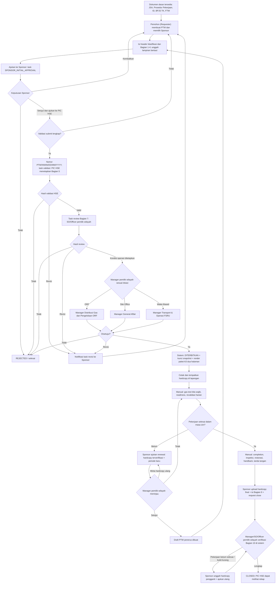

# Business Requirements Document (BRD)
## Nusantara Regas Permit to Work Online

| Atribut | Nilai |
| --- | --- |
| Produk | NR PTW Online |
| Versi | 1.8 — penyelarasan flow dengan sistem berjalan: review Bagian 7 SO/Officer, pembagian pengisian formulir, renewal dan closure berbasis hardcopy terverifikasi |
| Tanggal | 25 September 2026; Amendemen 1: 21 Oktober 2026 (lihat Bagian 0.1) |
| Status | Disahkan sebagai baseline 25 September 2026 (DEC-128); diamendemen 21 Oktober 2026 mengikuti UAT-2026-10-12, HSE-SPONSOR-SELF-VALIDATION, dan REQUESTER-PELAKSANA-SIGNATURE |
| Pemilik bisnis yang diusulkan | Fungsi Operasi/HSSE Nusantara Regas |
| Dokumen terkait | [PRD v1.8](PRD-NR-PTW-Online-v1.8-ID.md), [FSD v1.8](FSD-NR-PTW-Online-v1.8-ID.md) |
| Menggantikan | BRD v1.7 (16 September 2026) |

## 0. Ringkasan perubahan v1.8

Versi 1.8 tidak mengubah tujuan bisnis, tetapi menyelaraskan alur yang pada v1.7 bertolak belakang dengan sistem yang telah berjalan dan diterima pengguna. Perubahan material:

| Area | v1.7 | v1.8 |
| --- | --- | --- |
| Gate sebelum penerbitan | Validasi PIC HSE langsung diikuti approval Manager pemilik wilayah | Validasi PIC HSE → **review kondisi operasi Bagian 7 oleh SO/Officer pemilik wilayah** → approval dan penerbitan Manager pemilik wilayah |
| Pemisahan tugas | Sponsor ≠ validator HSE; Manager berbeda dari Sponsor | **Empat aktor berbeda**: Sponsor, PIC HSE, reviewer SO/Officer, Manager penerbit. *Amendemen 20 Okt 2026 (DEC-130):* Sponsor yang memegang PIC HSE boleh memvalidasi PTW-nya sendiri; SoD tetap untuk reviewer Bagian 7 dan Manager penerbit |
| Pengisian formulir | Sponsor mengisi Bagian 1–5/7 termasuk CLSR, SIMOPS, safety, isolasi/precaution | Sponsor mengisi **Bagian 1–4**; PIC HSE menetapkan **Bagian 5**; SO/Officer menetapkan **checklist kondisi operasi Bagian 7**; Manager mengisi baris approval Bagian 7. Tidak ada input CLSR/SIMOPS/isolasi bebas oleh Sponsor |
| Dokumen wajib | Matriks requirement terversi; JSA wajib | **JSA, Prosedur Pekerjaan, ID, BPJS TK, dan FTW** wajib berlampiran sebelum submit; JSA dan Prosedur Pekerjaan otomatis menjadi checklist wajib Bagian 4, sedangkan tiga evidence lainnya tidak dicetak di Bagian 4. E-SIMI dihapus dari dokumen wajib (DEC-129, UAT-2026-10-12 no. 1) |
| Renewal | Sponsor langsung membuat draft turunan dari PTW `ISSUED`/`EXPIRED` | Sponsor mengajukan **permintaan renewal dengan hardcopy hasil verifikasi lapangan**; Manager pemilik wilayah meninjau; **draft penerus lahir hanya setelah approval** |
| Closure | Pemilik wilayah memverifikasi bukti lalu menutup | Pemilik wilayah mengisi **verifikasi Bagian 10 terstruktur**; jalur "pekerjaan belum selesai" mengunci close dan meminta hardcopy pengganti untuk paket cetak yang sama |
| Revisi | Task kembali ke pengaju | Permintaan revisi membuat **notifikasi task kepada Sponsor PTW**; submit ulang menaikkan versi PTW |
| Paket cetak | A3 boleh dipecah menjadi A4 multipage; menyertakan QR dan halaman kampanye | **Dua halaman A3 setia pada FM-001/002/003-B-002-NR-B220** (halaman 1 landscape Bagian 1–7 dengan blok pengingat HSSE di bawahnya, halaman 2 portrait hanya Bagian 8; Bagian 9–10 digital sejak DEC-129); QR dan halaman kampanye keluar dari rilis awal |
| Identitas | OIDC/IdP korporat | Login memverifikasi kredensial melalui **Portal API** dua langkah: kredensial service memperoleh bearer dari `SecureAuth`, lalu bearer mengotorisasi `ADAuth` yang memeriksa username/password pengguna terhadap Active Directory (`true` sah, `false` salah, respons lain/timeout = tidak tersedia); fallback ke akun lokal terkelola, cookie HTTP-only, role/scope dari assignment yang disetujui (OPN-007 bagian 1 ACCEPTED 24 Sep 2026; kontrak dua langkah diverifikasi live 30 Sep 2026). Tidak ada OIDC/SSO baru sebagai prasyarat |

## 0.1 Amendemen pasca-v1.8 (21 Oktober 2026)

Setelah pengesahan baseline 25 September 2026, keputusan berikut disahkan dan telah diimplementasikan. Bila teks tubuh dokumen ini bertentangan dengan record di bawah, record tersebut yang berlaku (lihat juga DEC-129 sampai DEC-131 pada Bagian 2.2):

| Record | Tanggal | Ringkasan perubahan terhadap v1.8 |
| --- | --- | --- |
| [UAT-2026-10-12](decisions/UAT-2026-10-12.md) / [PTW-WORKFLOW-BASELINE Amendemen 3](decisions/PTW-WORKFLOW-BASELINE.md) | 12 dan 20 Oktober 2026 | E-SIMI dihapus seluruhnya; role `Requester` (Pemohon) mengisi setiap PTW dan Sponsor menyetujui/mengembalikan/menolak PTW awal di dalam `DRAFT`; nomor `PTW/NNNN/DD/MM/YYYY` reset tahunan; Bagian 9 dan 10 digital dan halaman 2 paket cetak berakhir pada Bagian 8; blok pengingat HSSE pada halaman 1; label PJS Manager dari assignment `Delegation`; self check revisi Sponsor dan PIC HSE; pilihan APD tersimpan; label `Sertifikat Pekerja`; pagination, upload per dokumen, batas ukuran, pratinjau lampiran |
| [HSE-SPONSOR-SELF-VALIDATION](decisions/HSE-SPONSOR-SELF-VALIDATION.md) | 20 Oktober 2026 | Sponsor yang memegang `HSEValidator` boleh memvalidasi PTW-nya sendiri; SoD tetap untuk review Bagian 7 dan penerbitan |
| [REQUESTER-PELAKSANA-SIGNATURE](decisions/REQUESTER-PELAKSANA-SIGNATURE.md) | 21 Oktober 2026 | Slot tanda tangan Pelaksana Pekerjaan Bagian 3 diisi spesimen dan waktu pengajuan akun Pemohon; kosong bila PTW tidak diinisiasi Pemohon |
| [OPN-007](decisions/OPN-007.md) (kontrak Portal dua langkah) | diverifikasi live 30 September 2026 | Login memakai `SecureAuth` (bearer dari kredensial service) lalu `ADAuth` (verifikasi kredensial pengguna, hasil boolean); keputusan identitas tidak berubah |

## 1. Ringkasan eksekutif

NR PTW Online adalah sistem internal untuk mendigitalkan proses Izin Kerja (*Permit to Work/PTW*) Nusantara Regas tanpa mengurangi kontrol keselamatan yang saat ini terdapat pada formulir manual. E-SIMI yang telah dimiliki NR tetap mengendalikan izin masuk instalasi, sedangkan PTW mengendalikan izin melaksanakan pekerjaan tertentu pada lokasi, periode, dan kondisi lapangan tertentu; persetujuan salah satunya tidak menggantikan yang lain. Sejak UAT-2026-10-12 (DEC-129) PTW **tidak lagi merekam nomor E-SIMI maupun mewajibkan lampiran E-SIMI**, dan integrasi E-SIMI tidak lagi menjadi backlog.

Pemohon (role `Requester`; akun Kontraktor hanya memegang role ini) menyusun PTW beserta dokumen dasar wajib dan mengajukannya kepada Sponsor NR; Sponsor memeriksa, mengedit bila perlu, lalu menyetujui (sekaligus mengajukan ke PIC HSE), mengembalikan untuk revisi, atau menolak (DEC-129). Setiap submission divalidasi oleh **satu validator, yaitu PIC HSE**, yang sekaligus menetapkan APD/perlengkapan safety Bagian 5. Setelah validasi, **SO/Officer departemen pemilik wilayah** memverifikasi kondisi operasi Bagian 7 (isolasi, depressurized, drained, ventilated, bilas, dan lainnya) berdasarkan kondisi aktual area. Barulah **Manager departemen pemilik wilayah**, atau PJS Manager yang memegang role itu melalui assignment `Delegation` yang masih berlaku (DEC-129), memberikan approval penerbitan. Sistem menetapkan status **DITERBITKAN (`ISSUED`)** secara atomik, mengunci snapshot, dan menghasilkan paket PTW siap cetak yang setia pada formulir terkontrol beserta bukti persetujuan elektronik. Departemen pemilik wilayah bukan validator HSE.

Rilis awal menggunakan model hibrida pada **tiga lokasi aktif: ORF, Site Office, dan Water-Based Activity**. Pemilik wilayah ditentukan otomatis dari lokasi: ORF dimiliki Departemen Distribusi Gas dan Pengelolaan ORF; Site Office dimiliki Departemen General Affair; dan Water-Based Activity dimiliki Departemen Transport & Operasi FSRU. Pengajuan, validasi, review kondisi operasi, approval penerbitan, pelacakan, perpanjangan, dan penutupan dikelola dalam aplikasi. Hardcopy resmi tetap ditempatkan di lapangan; gas test awal, revalidasi harian, pembukaan/penutupan harian, dan tanda tangan lapangan diisi manual pada lembar cetak. Pada akhir pekerjaan, Sponsor mengunggah hardcopy lengkap sebagai bukti, lalu pemilik wilayah memverifikasi Bagian 10 dan menutup PTW. PIC HSE tidak menjadi approver penutupan, tetapi memperoleh visibilitas dan rekap.

Solusi dibangun sebagai aplikasi modular baru. SQL Server menjadi *system of record* untuk data PTW; E-SIMI tetap menjadi *system of record* izin masuk dan tidak terhubung dengan PTW (DEC-129). Target teknologi dijelaskan pada PRD dan FSD: ASP.NET Core 10/.NET 10 LTS, Angular 22, SQL Server 2025, dan Docker Compose.

## 2. Tujuan dokumen dan otoritas sumber

BRD ini menyepakati kebutuhan dan aturan bisnis. Jika sumber bertentangan, urutan otoritas yang diusulkan adalah:

1. SOP PTW NR yang berlaku dan revisi yang disahkan.
2. Keputusan tertulis Product Owner, Operasi, HSSE, dan TI.
3. Formulir PTW terkontrol FM-001/002/003-B-002-NR-B220 beserta maksud kontrol keselamatannya.
4. Perilaku sistem yang telah diterima pengguna sampai 21 Oktober 2026 (DEC-117 sampai DEC-131).
5. Keputusan yang dikonfirmasi dari rapat progress 7 September 2026 dan rapat tindak lanjut 12 Agustus 2026.
6. BRD, PRD, dan pola operasional E-SIMI milik NR.
7. Benchmark PGE/JPO sebagai referensi, bukan kebijakan NR.

### 2.1 Sumber analisis

| Sumber | Pemanfaatan |
| --- | --- |
| Formulir terkontrol FM-001/002/003-B-002-NR-B220 | Struktur izin, tiga kelas izin, sepuluh bagian formulir, klasifikasi header, katalog Bagian 1/4/5/7, masa berlaku maksimum tujuh hari |
| Rekaman rapat 12 Agustus 2026 | Arah ruang lingkup, sponsor internal, integrasi E-SIMI, otorisasi berbasis kompetensi, gas test kondisional, validasi harian |
| Gambar alur benchmark JHSEA/PGE | Referensi create/copy/extend, review, dan jalur persetujuan berbasis risiko |
| BRD, PRD, README E-SIMI | Konteks izin masuk, data organisasi, identitas, notifikasi, audit, dan kebutuhan integrasi |
| Klarifikasi flow dan lokasi, 1 September 2026 | Kontraktor/User Sponsor dapat mengajukan; approval dan penerbitan mengikuti pemilik area |
| Klarifikasi otoritas approval, 1 September 2026 | Approval menuju penerbitan wajib dilakukan Manager pemilik area atau pejabat pengganti dengan penugasan/delegasi resmi yang aktif |
| Rekaman rapat progress 7 September 2026 | Paritas isi template, penghapusan duplikasi bahaya/kontrol, paket cetak, operasi lapangan manual, bukti hardcopy saat close, penyederhanaan approver penutupan, renewal, dan pilot ORF |
| Klarifikasi validator, 8 September 2026 | Validator tunggal PIC HSE; departemen pemilik wilayah bukan validator |
| Klarifikasi lokasi aktif dan pemilik wilayah, 16 September 2026 | ORF, Site Office, dan Water-Based Activity aktif; pemilik wilayah Site Office adalah General Affair dan Water-Based Activity adalah Transport & Operasi FSRU |
| Arahan kesetiaan template cetak, 16 September 2026 | Paket cetak wajib mereproduksi formulir terkontrol; layout digital alternatif atau template placeholder ditolak; materi kampanye tidak berlaku pada rilis awal |
| Verifikasi sistem berjalan, 22 September 2026 | Flow review Bagian 7 SO/Officer, pembagian pengisian Bagian 1–7, dokumen dasar wajib, renewal/closure berbasis hardcopy terverifikasi, notifikasi revisi, identitas lokal Development dikonfirmasi sesuai dan diadopsi sebagai baseline v1.8 |
| Klarifikasi dokumen wajib, 24 September 2026 | Prosedur Pekerjaan yang wajib diunggah juga wajib otomatis dicentang dan dicetak sebagai item Bagian 4 |
| Pengesahan alur sistem, 25 September 2026 | Sistem yang berjalan beserta alurnya disetujui pengguna sebagai baseline operasional (`docs/decisions/PTW-WORKFLOW-BASELINE.md`) |
| Pengesahan stakeholder, 25 September 2026 | Keadaan sistem dan alur dikukuhkan Product Owner bersama Operasi, HSSE, General Affair, Transport & Operasi FSRU, dan TI; disposisi OPN dicatat pada PTW-WORKFLOW-BASELINE Amendemen 2 |

### 2.2 Keputusan flow sampai versi 1.8

| ID | Keputusan | Status |
| --- | --- | --- |
| DEC-101 | Pengajuan dapat dibuat oleh Kontraktor atau User Sponsor. | **Digantikan DEC-129**: setiap PTW diisi pemegang role `Requester` (Pemohon) dan disetujui Sponsor |
| DEC-102 | Setiap submission divalidasi oleh tepat satu validator: PIC HSE. | Dikonfirmasi |
| DEC-103 | Sistem membuat satu validation task aktif untuk PIC HSE pada setiap submission. | Dikonfirmasi v1.6 |
| DEC-104 | Approval baru dapat berjalan setelah validasi PIC HSE berstatus valid pada PermitVersion yang sama. | Diperluas DEC-118: approval juga mensyaratkan review Bagian 7 selesai pada versi yang sama |
| DEC-105 | Approval dan penerbitan PTW mengikuti departemen pemilik area. | Dikonfirmasi |
| DEC-106 | Pemetaan pemilik area awal. | Digantikan DEC-116 |
| DEC-107 | Istilah resmi setelah approval penerbitan adalah **PTW Diterbitkan** (`ISSUED`), bukan `OPEN`. Kesiapan mulai/lanjut kerja tetap dikendalikan terpisah melalui isian dan tanda tangan hardcopy. | Dikonfirmasi |
| DEC-108 | Approval pemilik area sebelum penerbitan wajib dilakukan oleh Manager departemen pemilik area atau pejabat pengganti yang ditunjuk resmi, memiliki scope yang sama, dan masih efektif. | Dikonfirmasi; PJS Manager diturunkan dari assignment `Delegation` sejak DEC-129 (UAT no. 13), model penugasan pengganti yang lebih lengkap tetap backlog |
| DEC-109 | Isi kontrol pada tiga template PTW dipertahankan; tata letak digital/cetak boleh dioptimalkan. | **Digantikan DEC-117** untuk paket cetak; layar aplikasi tetap boleh dioptimalkan |
| DEC-110 | Bahaya dan pengendalian tidak diketik ulang pada form PTW; rincian bersumber dari JSA terlampir. Referensi bahaya tambahan Bagian 2 bersifat opsional dan informatif. | Dikonfirmasi |
| DEC-111 | Setelah approval penerbitan, sistem menghasilkan paket PTW siap cetak dengan bukti persetujuan dan lembar lapangan. | Dikonfirmasi |
| DEC-112 | Gas test, revalidasi harian, pembukaan/penutupan harian, dan tanda tangan lapangan tetap manual pada hardcopy. | Dikonfirmasi |
| DEC-113 | Close mewajibkan upload hardcopy lengkap; Sponsor mengajukan penutupan dan pemilik area memverifikasi. PIC HSE tidak meng-approve close, tetapi memperoleh rekap. | Diperluas DEC-122 |
| DEC-114 | Pilot difokuskan pada ORF. | Digantikan DEC-116 |
| DEC-115 | Perpanjangan dicatat sebagai PTW turunan maksimum tujuh hari, tidak overlap, memerlukan dokumen/attachment baru, dan menghasilkan paket cetak baru. | Diperluas DEC-121 |
| DEC-116 | Lokasi aktif rilis awal: ORF (Distribusi Gas dan Pengelolaan ORF), Site Office (General Affair), Water-Based Activity (Transport & Operasi FSRU). HO dan FSRU tidak aktif. | Dikonfirmasi 16 Sep 2026 |
| DEC-117 | Paket cetak resmi mereproduksi formulir terkontrol FM-001/002/003-B-002-NR-B220 sebagai dua halaman A3: halaman 1 landscape memuat Bagian 1–7 dan halaman 2 portrait dimulai pada Bagian 8. Teks, urutan item, kolom, dan kotak centang mengikuti formulir; tidak ada layout digital alternatif, template placeholder, atau pemecahan A4. | Dikonfirmasi 16 Sep 2026; diadopsi v1.8; dipersempit DEC-129 (halaman 2 hanya Bagian 8, blok pengingat HSSE pada halaman 1, label `Sertifikat Pekerja`) |
| DEC-118 | Setelah validasi PIC HSE, **SO/Officer departemen pemilik wilayah** memverifikasi kondisi operasi Bagian 7 melalui satu task review. Reviewer pertama yang menyelesaikan task menang. Manager pemilik wilayah baru dapat menyetujui dan menerbitkan setelah review tersebut selesai pada versi PTW yang sama. | Dikonfirmasi 22 Sep 2026 |
| DEC-119 | Pembagian pengisian formulir: Sponsor mengisi Bagian 1–4 (klasifikasi header, jenis pekerjaan, penjelasan pekerjaan, permintaan izin kerja, dokumen pendukung); PIC HSE menetapkan Bagian 5 saat validasi; SO/Officer menetapkan checklist kondisi operasi Bagian 7; Manager mengisi baris approval Bagian 7 melalui keputusan penerbitan. Bagian 6 dan Bagian 8–10 dicetak kosong untuk pengisian lapangan. | Dikonfirmasi 22 Sep 2026; sejak DEC-129 Bagian 9 diisi Sponsor saat permintaan penutupan dan Bagian 10 oleh Pemilik Wilayah di sistem, hanya Bagian 6 dan 8 yang tetap hardcopy |
| DEC-120 | Sebelum submit, JSA, ID, BPJS TK, FTW, dan E-SIMI wajib memiliki lampiran bertaut. Hanya JSA yang juga menjadi item checklist Bagian 4; empat dokumen lainnya adalah evidence pengajuan dan tidak dicetak pada Bagian 4. | Diperluas DEC-127; E-SIMI dihapus DEC-129 |
| DEC-121 | Renewal tidak mengubah PTW asal. Sponsor mengajukan permintaan renewal dengan hardcopy hasil verifikasi lapangan yang cocok dengan paket cetak resmi, periode baru non-overlap maksimum tujuh hari, dan pernyataan kelanjutan. Manager pemilik wilayah dapat meminta hardcopy ulang, menolak, atau menyetujui; draft PTW penerus dibuat atomik hanya saat approval dan menjalani workflow normal dari awal. | Dikonfirmasi 22 Sep 2026 |
| DEC-122 | Penutupan diverifikasi Manager atau SO/Officer pemilik wilayah dengan assignment efektif dan scope lokasi yang cocok, melalui satu task pool dan isian Bagian 10 terstruktur: nama Officer pemeriksa, area diinspeksi dan bersih, pekerjaan selesai, Pemilik Wilayah menyetujui penyelesaian, sistem yang di-inhibit dipulihkan, area di-handback dan pengaman dipulihkan, serta hardcopy terbaca. Signed field copy pilihan Sponsor menjadi unduhan utama PTW untuk review dan arsip close. Bila pekerjaan belum selesai, close terkunci; Sponsor mengunggah hardcopy pengganti untuk paket cetak yang sama dan mengajukan ulang tanpa mengubah status. | Dikonfirmasi 22 Sep 2026; kewenangan close diperluas 23 Sep 2026 |
| DEC-123 | Permintaan revisi membatalkan task yang tertunda dan membuat notifikasi task kepada Sponsor PTW. Submit ulang menaikkan versi PTW meskipun draft tidak berubah, dan seluruh task/evidence versi lama menjadi riwayat. | Dikonfirmasi 22 Sep 2026 |
| DEC-124 | QR/reference pada lembar cetak serta halaman kampanye (10 CLSR, 8 Arahan Direksi, 9 Perilaku Wajib) tidak termasuk paket cetak rilis awal; keduanya menjadi backlog setelah OPN-011/OPN-012 disahkan. | Dikonfirmasi 16 Sep 2026 |
| DEC-125 | Rilis Development memakai akun lokal terkelola, login cookie HTTP-only, dan assignment role yang disetujui Administrator; role dan scope dihitung ulang setiap request. Spesimen tanda tangan visual berversi dicetak sebagai bukti persetujuan elektronik, bukan tanda tangan digital tersertifikasi. SSO/IdP produksi menunggu OPN-007. | Dikonfirmasi 22 Sep 2026; identitas produksi diperbarui OPN-007 bagian 1 (Portal API + akun lokal, 24 Sep 2026) |
| DEC-126 | Deklarasi SIMOPS, elemen CLSR bebas, dan isolasi/precaution bebas tidak ditampilkan pada form Sponsor karena tidak terdapat pada formulir terkontrol; kondisi operasi ditetapkan SO/Officer pada Bagian 7. | Dikonfirmasi 22 Sep 2026 |
| DEC-127 | Prosedur Pekerjaan wajib memiliki lampiran bertaut sebelum submit dan otomatis menjadi item wajib checklist Bagian 4 serta paket cetak. Sponsor tidak dapat membatalkan pilihannya. ID, BPJS TK, FTW, dan E-SIMI tetap hanya menjadi evidence pengajuan dan tidak ditambahkan ke Bagian 4. | Dikonfirmasi 24 Sep 2026; E-SIMI dihapus DEC-129 |
| DEC-128 | Sistem yang berjalan saat ini beserta alurnya (lifecycle, validator HSE tunggal, review Bagian 7 SO/Officer, approve-and-issue Manager, closure pool Bagian 10, renewal berbasis review, dokumen wajib, katalog terkontrol, paket cetak dua halaman, tiga lokasi aktif, login Portal) disahkan sebagai baseline operasional. Perubahan berikutnya memerlukan superseding record. | Disahkan pengguna 25 Sep 2026; dikukuhkan stakeholder 25 Sep 2026 (Amendemen 2); diamendemen DEC-129 sampai DEC-131 |
| DEC-129 | Tindak lanjut UAT 12 Oktober 2026 (18 temuan, [UAT-2026-10-12](decisions/UAT-2026-10-12.md), PTW-WORKFLOW-BASELINE Amendemen 3): E-SIMI dihapus seluruhnya dari draft, dokumen wajib, dan UI; setiap PTW diisi pemegang role `Requester` (Pemohon; akun Kontraktor hanya memegang role ini) yang memilih Sponsor dan mengajukan PTW awal (`initial-submit`, task `SPONSOR_INITIAL_APPROVAL`), lalu Sponsor mengedit bila perlu dan menyetujui (`approve-initial`, sekaligus mengajukan ke PIC HSE dan mengalokasikan nomor resmi dalam satu transaksi), mengembalikan (`return-initial`), atau menolak (`reject-initial`, `REJECTED`) di dalam status `DRAFT`; nomor resmi `PTW/NNNN/DD/MM/YYYY` dengan urutan yang direset tiap tahun WIB dialokasikan dalam transaksi submit; Bagian 9 diisi Sponsor secara digital saat permintaan penutupan dan Bagian 10 oleh Pemilik Wilayah, keduanya masuk audit, sehingga halaman 2 paket cetak berakhir pada Bagian 8; blok pengingat HSSE (empat kalimat PASTIKAN) dicetak di bawah halaman 1; approver yang memegang Manager Pemilik Wilayah hanya lewat assignment `Delegation` dicatat dan dicetak sebagai PJS Manager tanpa aturan approval tambahan; submit ulang mewajibkan self check Sponsor dan validasi versi hasil revisi mewajibkan self check PIC HSE; pilihan APD PIC HSE dapat disimpan terpisah dan bertahan melewati revisi; label Bagian 4 `Sertifikat Pekerja`; pagination, tombol unggah per dokumen, batas ukuran upload, dan pratinjau lampiran. | Disahkan 12 Okt 2026 (temuan) dan 20 Okt 2026 (parameter) |
| DEC-130 | Sponsor PTW yang memegang role `HSEValidator` boleh memvalidasi PTW-nya sendiri dan menetapkan Bagian 5; pasangan SoD lainnya tetap (Sponsor/validator HSE bukan reviewer Bagian 7; Manager penerbit berbeda dari Sponsor, validator HSE, dan reviewer). | Disahkan 20 Okt 2026 ([HSE-SPONSOR-SELF-VALIDATION](decisions/HSE-SPONSOR-SELF-VALIDATION.md)) |
| DEC-131 | Slot tanda tangan Pelaksana Pekerjaan Bagian 3 pada paket cetak diisi spesimen tanda tangan berversi dan waktu pengajuan ke Sponsor dari akun Pemohon yang mengajukan PTW; baris nama tetap dari field `Nama pelaksana`; PTW tanpa inisiasi Pemohon membiarkan slot kosong untuk hardcopy. Tetap bukti persetujuan elektronik, bukan PSrE. | Disahkan 21 Okt 2026 ([REQUESTER-PELAKSANA-SIGNATURE](decisions/REQUESTER-PELAKSANA-SIGNATURE.md)) |

## 3. Latar belakang dan masalah bisnis

Proses kertas saat ini memiliki kontrol keselamatan yang penting, tetapi menimbulkan kelemahan operasional:

- status izin, pihak yang harus bertindak, dan masa kedaluwarsa tidak terlihat secara real time;
- kewenangan penandatangan dan masa berlaku kompetensi tidak dapat diperiksa otomatis;
- data pekerjaan, JSA, isolasi, hasil gas test, validasi harian, dan handback tersebar;
- keterkaitan dengan dokumen pendukung sulit direkonsiliasi;
- perubahan kondisi atau penangguhan berisiko hanya tercatat pada lembar fisik;
- pelaporan dan audit membutuhkan kompilasi manual;
- persetujuan administratif berpotensi disalahartikan sebagai izin mulai bekerja.

## 4. Sasaran dan indikator keberhasilan

### 4.1 Sasaran bisnis

1. Menyediakan satu rekaman PTW digital yang dapat ditelusuri dari draft sampai penutupan.
2. Menjamin kontrol dan dokumen wajib mengikuti kelas izin, formulir terkontrol, lokasi, dan kondisi pekerjaan.
3. Memastikan hanya personel dengan peran, wilayah, dan otorisasi aktif yang dapat bertindak, dengan pemisahan tugas pada jalur penerbitan (Sponsor/validator HSE bukan reviewer Bagian 7; Manager penerbit berbeda dari Sponsor, validator HSE, dan reviewer; Sponsor yang memegang PIC HSE boleh memvalidasi PTW-nya sendiri sejak DEC-130).
4. Memisahkan persetujuan rencana dari verifikasi kesiapan lapangan dan izin mulai kerja.
5. Memberikan visibilitas izin aktif, tertunda, kedaluwarsa, renewal, dan pekerjaan yang belum di-handback.
6. Mengurangi duplikasi melalui dokumen dasar yang diunggah sekali per PTW dan dapat dipratinjau di aplikasi.

### 4.2 KPI yang diusulkan

| KPI | Definisi | Target awal; dikonfirmasi PO |
| --- | --- | --- |
| Kelengkapan saat submit | Persentase submission yang lolos validasi PIC HSE pertama | ≥ 90% setelah 3 bulan |
| Waktu keputusan | Median dari submit sampai Diterbitkan, di luar waktu revisi pemohon | ≤ 1 hari kerja |
| Kepatuhan otorisasi | Aksi terkontrol oleh personel dengan otorisasi aktif | 100% |
| Ketertiban penutupan | PTW selesai yang ditutup dengan verifikasi Bagian 10 | ≥ 98% |
| Bukti revalidasi | Hardcopy final memuat validasi harian/shift yang diwajibkan dan terbaca | 100% sampel close |
| Keterlacakan audit | Transisi material dengan aktor, waktu, alasan, dan versi | 100% |
| Duplikasi data | PTW dengan kelima dokumen dasar (JSA, Prosedur Pekerjaan, ID, BPJS TK, FTW) berlampiran sebelum submit | 100% |

## 5. Ruang lingkup

### 5.1 Dalam lingkup MVP

- cakupan operasional awal untuk ORF, Site Office, dan Water-Based Activity dengan pemilik wilayah sesuai matriks Bagian 6.1;
- akun terkelola untuk pengguna internal dan Kontraktor, dengan otorisasi berbasis peran, lokasi, dan assignment yang disetujui;
- pembuatan PTW oleh Pemohon (role `Requester`, termasuk akun Kontraktor) untuk Pekerjaan Panas, Pekerjaan Dingin, dan Memasuki Ruang Terbatas (CSE), pengajuan ke Sponsor, lalu persetujuan awal Sponsor yang sekaligus mengajukan ke PIC HSE (DEC-129);
- pengisian Bagian 1–4 oleh Sponsor sesuai katalog formulir terkontrol: klasifikasi header, jenis pekerjaan, penjelasan pekerjaan dan equipment, pihak/perusahaan, dan checklist dokumen pendukung;
- dokumen dasar wajib (JSA, Prosedur Pekerjaan, ID, BPJS TK, FTW) sebagai lampiran terkontrol sebelum submit; JSA sebagai sumber rincian bahaya/pengendalian; JSA dan Prosedur Pekerjaan otomatis menjadi checklist Bagian 4;
- validasi wajib oleh PIC HSE yang sekaligus menetapkan Bagian 5, termasuk revisi/penolakan/eskalasi;
- review kondisi operasi Bagian 7 oleh SO/Officer pemilik wilayah;
- approval penerbitan oleh Manager pemilik wilayah; approval yang berhasil menerbitkan PTW dan mengunci snapshot dokumen;
- generator paket PDF/cetak dua halaman A3 yang setia pada formulir terkontrol, menampilkan bukti persetujuan elektronik (termasuk spesimen Pemohon pada slot Pelaksana Pekerjaan, DEC-131), blok pengingat HSSE pada halaman 1, dan menyediakan ruang manual Bagian 6 serta Bagian 8; Bagian 9–10 tidak dicetak karena digital (DEC-129);
- penggunaan hardcopy di lapangan untuk gas test, validasi harian, pembukaan/penutupan harian, penyelesaian, inspeksi, restorasi, dan handback;
- pengajuan close oleh Sponsor dengan hardcopy final wajib dan pernyataan Bagian 9 digital, lalu verifikasi Bagian 10 digital oleh pemilik wilayah; PIC HSE memperoleh akses rekap tanpa task approval close;
- renewal berbasis review pemilik wilayah dengan nomor baru dan lineage; keputusan dan hasil pengujian tidak ikut disalin;
- notifikasi task, daftar tugas, dashboard peran, riwayat, dan audit trail;
- administrasi pengguna, assignment role, master lokasi effective-dated, dan kesiapan policy;
- deployment dengan Docker Compose.

### 5.2 Di luar lingkup MVP

- akses anonim atau registrasi mandiri publik; akses Kontraktor harus melalui onboarding dan akun terkelola;
- authoring/approval elektronik JSA, SOP, MOC, lifting plan, atau LOTO sebagai subproses tersendiri;
- pengisian gas test, validasi harian, work period, dan tanda tangan pelaksana secara online;
- integrasi otomatis alat gas detector, badge/gate, CCTV, atau sensor;
- keterkaitan dengan E-SIMI dalam bentuk apa pun (referensi, lampiran, maupun integrasi API) sejak DEC-129;
- aplikasi mobile native dan operasi offline penuh;
- penggantian atau migrasi aplikasi E-SIMI;
- aktivasi operasional HO dan FSRU pada rilis awal;
- QR/reference pada lembar cetak dan halaman kampanye keselamatan (DEC-124);
- rules engine deklaratif dan master checklist effective-dated; rilis awal memakai katalog formulir terkontrol yang ditranskripsi dari template;
- tanda tangan digital tersertifikasi PSrE, kecuali disetujui sebagai fase lanjutan.

### 5.3 Pemetaan sepuluh bagian formulir terkontrol

| Bagian formulir | Pengisi | Perlakuan digital v1.8 |
| --- | --- | --- |
| Header klasifikasi | Sponsor | HOT: satu atau lebih dari `Api Terbuka`/`Percikan Api`; COLD: tepat satu dari `Low Risk`/`High Risk`; CSE: tanpa kotak tambahan. Wajib sebelum submit. |
| 1. Jenis Pekerjaan | Sponsor | Multi-select dari katalog per kelas izin sesuai formulir; opsi `Lain-lain` mewajibkan detail maksimum 80 karakter yang ikut tercetak. |
| 2. Penjelasan Pekerjaan | Sponsor | Uraian, nomor/nama equipment, Work Order No., plant/area, masa berlaku, dan referensi bahaya tambahan opsional. Tidak ada kolom bebas bahaya/pengendalian yang menduplikasi JSA. |
| 3. Permintaan Izin Kerja | Sponsor (sistem mencetak) | Nama, jabatan, departemen, spesimen tanda tangan berversi, dan waktu submit Sponsor dicetak dari profil akun; slot tanda tangan Pelaksana Pekerjaan diisi spesimen dan waktu pengajuan akun Pemohon (DEC-131), kosong bila PTW tidak diinisiasi Pemohon; baris nama tetap dari field `Nama pelaksana`. |
| 4. Dokumen Pendukung | Sponsor | 15 pilihan sesuai formulir (label `Sertifikat Pekerja` sejak DEC-129); JSA dan Prosedur Pekerjaan wajib serta otomatis terpilih, dengan metadata nomor/revisi/tanggal wajib untuk JSA; setiap pilihan harus memiliki lampiran bertaut sebelum submit. Dokumen dasar ID, BPJS TK, dan FTW wajib berlampiran tetapi tidak dicetak sebagai item Bagian 4. |
| 5. Perlengkapan Safety Tambahan/Khusus | PIC HSE | Ditetapkan saat validasi dari katalog per kelas izin (minimal satu). Sponsor tidak dapat mengisi; approval tanpa Bagian 5 ditolak dan diarahkan ke revisi. |
| 6. Gas Tes Awal | Lapangan | Dicetak kosong; Gas Tester mengisi dan menandatangani manual bila diwajibkan. |
| 7. Izin dari Bagian Operasi | SO/Officer dan Manager pemilik wilayah | Checklist kondisi operasi (`Isolasi` dengan rincian Closed/Lock Valves, Blind, Disconnect; `Depressurized`; `Drained`; `Ventilated`; `Bilas` dengan rincian N2 Purge, Water; `Lainnya` dengan penjelasan maksimum 200 karakter) ditetapkan SO/Officer. Baris keputusan SO/Officer dan Manager dicetak dengan nama, jabatan, spesimen tanda tangan, dan waktu. |
| 8. Revalidasi Izin Kerja | Lapangan | Dicetak kosong pada halaman 2 dengan ruang tulis hingga tujuh hari; halaman 2 berakhir pada rule bawah grid revalidasi. |
| 9. Pekerjaan Selesai | Sponsor di sistem (DEC-129) | Tidak dicetak. Diisi Sponsor saat permintaan/pengajuan ulang penutupan: status pekerjaan (selesai / belum selesai), peralatan dan material (sudah / belum dikeluarkan), penjelasan, nama dan No. ID Badge Pelaksana Pekerjaan, No. ID Badge Sponsor; masuk audit event. |
| 10. Inspeksi dan Pengembalian ke Operasi | Pemilik wilayah di sistem (DEC-129) | Tidak dicetak. Manager atau SO/Officer pemilik wilayah merekam verifikasi terstruktur Bagian 10 di sistem sebelum `CLOSED`; bila Sponsor menyatakan pekerjaan belum selesai, status pekerjaan dicatat dan PTW tetap dapat ditutup tanpa pernyataan "pekerjaan selesai". |

Katalog Bagian 1, 4, 5, dan 7 adalah transkripsi formulir terkontrol dan tidak boleh diubah tanpa decision record yang disahkan; pemindahannya ke master data effective-dated (OPN-003) tetap pekerjaan lanjutan.

## 6. Pemangku kepentingan dan peran

| Peran | Kode role sistem | Tanggung jawab utama | Aksi terkontrol |
| --- | --- | --- | --- |
| Product Owner | — | Menetapkan prioritas, aturan, KPI, dan acceptance | Menyetujui baseline produk |
| Pemohon (Kontraktor atau staf internal) | `Requester` (DEC-129; akun Kontraktor hanya memegang role ini) | Mengisi PTW awal beserta dokumen dasar untuk pekerjaan yang ia ajukan, memilih Sponsor NR, dan mengajukannya ke Sponsor; hanya melihat PTW yang ia inisiasi | Draft awal, unggah lampiran, `initial-submit`, perbaikan setelah dikembalikan Sponsor; tidak dapat submit ke PIC HSE |
| User Sponsor | `Sponsor` (tipe pengaju `CONTRACTOR`/`USER_SPONSOR` pada PTW) | Sponsor internal NR yang accountable atas PTW dan representasi crew; menyetujui PTW awal Pemohon | Edit draft awal, `approve-initial` (sekaligus mengajukan ke PIC HSE), `return-initial`, `reject-initial`, submit ulang setelah revisi, upload hardcopy, permintaan renewal, request/resubmit close dengan Bagian 9, cancel |
| Pelaksana/Performing Authority | — | Menjalankan metode kerja dan kontrol; validasi lapangan | Tidak wajib mempunyai akun; slot tanda tangannya pada Bagian 3 diisi spesimen akun Pemohon (DEC-131) |
| PIC HSE | `HSEValidator` | Validator tunggal yang memvalidasi kelengkapan, JSA, klasifikasi, dan menetapkan Bagian 5 | Validate, request revision, reject, escalate, suspend |
| SO/Officer Pemilik Wilayah | `AreaOwnerSeniorOfficer` (kode dipertahankan untuk kompatibilitas data) | Memverifikasi kondisi operasi aktual Bagian 7 dan dapat memverifikasi penutupan di wilayahnya | Review area operations; request revision/reject pada task review; verifikasi dan close |
| Manager Pemilik Wilayah | `AreaOwnerManager` | Manager departemen pemilik wilayah, atau PJS Manager yang memegang role ini hanya lewat assignment `Delegation` (DEC-129) | Approve-and-issue, request revision/reject, suspend, resolve suspension, review renewal, verifikasi dan close |
| Departemen Distribusi Gas dan Pengelolaan ORF | — | Pemilik wilayah ORF | Menyediakan SO/Officer dan Manager; bukan validator |
| Departemen General Affair | — | Pemilik wilayah Site Office | Menyediakan SO/Officer dan Manager; bukan validator |
| Departemen Transport & Operasi FSRU | — | Pemilik wilayah Water-Based Activity | Menyediakan SO/Officer dan Manager; bukan validator |
| Petugas Lapangan, Gas Tester, Isolating Authority, Site/Shift Supervisor | — | Mengisi bagian operasional pada hardcopy | Gas test/readiness/revalidasi/inspeksi/tanda tangan manual sesuai SOP |
| Administrator | `Administrator` | Mengelola akun, assignment role, master lokasi, spesimen tanda tangan, dan render ulang paket | Master data; retry render; expire manual; tidak boleh self-approve di luar Development |
| Auditor/Read-only | `Auditor` | Memeriksa bukti dan riwayat | Read/export sesuai cakupan |

Untuk approval pemilik wilayah, level Manager merupakan syarat bisnis. Aktor tetap harus memiliki assignment aktif, scope lokasi yang sesuai, dan memenuhi pemisahan tugas. Pejabat pengganti (PJS) hanya dapat bertindak bila memegang role Manager Pemilik Wilayah melalui assignment `Delegation` yang ditetapkan Administrator, efektif, dan dapat diaudit; approval-nya dicatat `ActingForManager` dengan assignment delegasi dan principal, serta berlabel PJS pada UI dan paket cetak (DEC-129). Model penugasan pengganti yang lebih lengkap tetap backlog OPN-002.

### 6.1 Matriks pemilik area

| Kode lokasi | Lokasi | Departemen pemilik area | Tanggung jawab pada flow |
| --- | --- | --- | --- |
| `HO` | Head Office (HO) | Departemen General Affair | **Tidak aktif**; target rollout berikutnya |
| `ORF` | ORF | Departemen Distribusi Gas dan Pengelolaan ORF | **Aktif**; menyediakan SO/Officer reviewer Bagian 7, Manager approver, Manager reviewer renewal, serta Manager/SO/Officer verifier close |
| `SITE_OFFICE` | Site Office | Departemen General Affair | **Aktif**; peran yang sama untuk Site Office |
| `FSRU` | FSRU | Departemen Transport & Operasi FSRU | **Tidak aktif**; target rollout berikutnya |
| `WATER_BASED` | Water-Based Activity | Departemen Transport & Operasi FSRU | **Aktif**; peran yang sama untuk Water-Based Activity |

Pemilik wilayah ditentukan dari lokasi utama PTW melalui konfigurasi release server-side. HO, FSRU, dan lokasi lain ditolak fail-closed saat submit. Pekerjaan lintas wilayah harus dipecah menjadi PTW terpisah.

## 7. Alur bisnis target

### 7.1 Makna status utama

| Status | Makna bisnis | Pekerjaan boleh berjalan? |
| --- | --- | --- |
| DRAFT | Sedang disusun Pemohon, atau menunggu/setelah keputusan awal Sponsor (task `SPONSOR_INITIAL_APPROVAL`/`REQUESTER_INITIAL_REVISION`, DEC-129) | Tidak |
| REVISION_REQUIRED | Harus diperbaiki; Sponsor menerima notifikasi task | Tidak |
| UNDER_VALIDATION | Validasi PIC HSE berjalan | Tidak |
| AWAITING_AREA_APPROVAL | Validasi PIC HSE lengkap; menunggu review Bagian 7 SO/Officer lalu approval Manager pemilik wilayah | Tidak |
| ISSUED | Approval penerbitan selesai, snapshot terkunci, dan paket cetak resmi tersedia | Hanya setelah seluruh isian/tanda tangan lapangan yang diwajibkan pada hardcopy dinyatakan valid |
| SUSPENDED | Izin berhenti sementara | Tidak |
| CLOSURE_REQUESTED | Sponsor telah mengunggah hardcopy final, mengisi Bagian 9, dan meminta penutupan; menunggu verifikasi Bagian 10 pemilik wilayah, termasuk siklus tindak lanjut | Tidak |
| CLOSED | Inspeksi/restorasi/handback terverifikasi | Tidak; terminal |
| REJECTED/CANCELLED/EXPIRED | Terminal; `EXPIRED` masih dapat menjadi sumber permintaan renewal atau closure; `REJECTED` juga dicapai dari `DRAFT` bila Sponsor menolak PTW awal Pemohon (`reject-initial`, DEC-129) | Tidak |

Permintaan renewal tidak menambah status pada PTW asal; ia dicatat sebagai evidence review yang menunggu keputusan pemilik wilayah.

## 8. Kebutuhan bisnis

Prioritas: **M** Must, **S** Should, **C** Could.

### 8.1 Identitas, kewenangan, dan pemisahan tugas

| ID | Kebutuhan | P |
| --- | --- | --- |
| BR-AUT-001 | Sistem hanya dapat digunakan oleh identitas yang terverifikasi: kredensial diverifikasi melalui Portal API dua langkah (`SecureAuth` dengan kredensial service untuk bearer, lalu `ADAuth` memeriksa kredensial pengguna terhadap Active Directory) dengan fallback akun lokal terkelola, sesi cookie HTTP-only, dan akun harus terdaftar serta aktif (OPN-007 bagian 1). | M |
| BR-AUT-002 | Setiap aksi terkontrol memvalidasi peran, cakupan lokasi, kepemilikan Sponsor, masa otorisasi, dan status PTW. Role dan scope dihitung ulang dari assignment yang disetujui dan efektif pada setiap request. | M |
| BR-AUT-003 | Pemisahan tugas pada jalur penerbitan: Sponsor dan validator HSE tidak boleh menjadi reviewer SO/Officer Bagian 7, dan Manager penerbit harus berbeda dari Sponsor, validator HSE, dan reviewer. Sponsor yang memegang `HSEValidator` boleh memvalidasi PTW miliknya sendiri (DEC-130); bila demikian ia otomatis tersingkir dari dua tahap berikutnya. | M |
| BR-AUT-004 | Assignment role menyimpan pengguna, role, area kewenangan bila role area-scoped, tanggal mulai, dan tanggal akhir opsional; action code dan kompetensi diturunkan sistem dari profil role, bukan input pengguna. | M |
| BR-AUT-005 | Pencabutan/berakhirnya otorisasi atau nonaktifnya akun langsung memblokir aksi baru tanpa menghapus bukti lama. | M |
| BR-AUT-006 | Kontraktor (akun `Requester`) hanya dapat mengakses PTW yang ia inisiasi (`InitiatedBy`) melalui akun terverifikasi; tidak ada anonymous atau self-registration. Scope perusahaan eksplisit menunggu OPN-006. | M |
| BR-AUT-007 | Akun Kontraktor harus memiliki sponsor/penanggung jawab NR, perusahaan, masa aktif, dan proses revoke. | S |
| BR-AUT-008 | PJS Manager ditentukan server dari assignment `Delegation` (DEC-129): aktor yang memegang `AreaOwnerManager` hanya lewat delegasi (claim `acting_role`) menghasilkan evidence `ActingForManager` dengan `ActingAssignmentId` dan principal dari assignment sumber, berlabel PJS pada UI dan baris Manager Bagian 7; payload klien diabaikan dan tidak ada aturan approval tambahan. Model penugasan pengganti yang lebih lengkap (dasar/nomor dokumen, batas risiko, lifecycle pencabutan, pengesah) tetap backlog OPN-002. | M |
| BR-AUT-009 | Task tidak dapat dialihkan secara ad hoc. Task yang ditujukan kepada identitas tertentu (misalnya notifikasi revisi Sponsor) terlihat oleh identitas tersebut walaupun role aktifnya berubah; task pool terlihat oleh pemegang role dengan scope lokasi yang cocok. | M |
| BR-AUT-010 | Nama dan jabatan aktor pada evidence workflow dan paket cetak berasal dari profil akun di server; username/ID tidak menjadi pengganti nama. | M |
| BR-AUT-011 | Administrator dapat mengunggah spesimen tanda tangan visual (PNG) berversi; versi lama tidak ditimpa dan versi exact dibekukan pada evidence/snapshot. | M |

### 8.2 Inisiasi PTW (E-SIMI dihapus)

| ID | Kebutuhan | P |
| --- | --- | --- |
| BR-INT-001 | Dihapus (UAT-2026-10-12 no. 1, DEC-129): PTW tidak menyimpan referensi E-SIMI dan tidak mewajibkan lampiran E-SIMI. | — |
| BR-INT-002 | Dihapus (DEC-129): integrasi API E-SIMI tidak lagi menjadi backlog. | — |
| BR-INT-003 | Dihapus (DEC-129). | — |
| BR-INT-004 | Dihapus (DEC-129). | — |
| BR-INI-001 | Setiap PTW baru dibuat oleh pemegang role `Requester` (Pemohon); Sponsor tanpa role tersebut tidak dapat membuat PTW (Administrator tetap dapat untuk pemeliharaan). Draft penerus renewal lahir dari approval pemilik wilayah dan diajukan ulang oleh Sponsor. | M |
| BR-INI-005 | Pemohon memilih Sponsor NR, melengkapi Bagian 1–4 dan lampiran, lalu mengajukan ke Sponsor; sistem membuat task `SPONSOR_INITIAL_APPROVAL` untuk Sponsor terpilih. Sponsor dapat mengedit draft, lalu menyetujui dengan konfirmasi persyaratan (sekaligus mengajukan ke PIC HSE dan mengalokasikan nomor resmi dalam satu transaksi), mengembalikan untuk revisi Pemohon (task `REQUESTER_INITIAL_REVISION`), atau menolak secara terminal (`REJECTED`, tanpa nomor PTW). Status lifecycle tetap `DRAFT` sampai persetujuan (DEC-129). | M |
| BR-INI-006 | Nomor resmi berformat `PTW/NNNN/DD/MM/YYYY`: `NNNN` nomor urut yang direset setiap tahun kalender WIB dan `DD/MM/YYYY` tanggal submit WIB, dialokasikan di dalam transaksi submit pertama dari counter tahunan; nomor tidak dipakai ulang, submit ulang mempertahankan nomor, dan nomor lama `PTW-YYYYMMDD-XXXX` tidak diubah (DEC-129). | M |
| BR-INI-002 | Draft penerus renewal menyalin data perencanaan Bagian 1–4 dengan periode yang disetujui, tetapi tidak menyalin lampiran, Bagian 5, Bagian 7, approval, atau isian lapangan. | M |
| BR-INI-003 | Sistem menyimpan jenis pengaju (`CONTRACTOR` atau `USER_SPONSOR`), perusahaan, pelaksana, dan Sponsor accountable. | M |
| BR-INI-004 | Bila pegawai HSE menjadi Sponsor pekerjaan, ia boleh memutuskan validation task HSE untuk PTW-nya sendiri (DEC-130); review Bagian 7 dan penerbitan tetap oleh orang lain. | M |

### 8.3 Klasifikasi, dokumen, dan formulir

| ID | Kebutuhan | P |
| --- | --- | --- |
| BR-CLS-001 | Sistem mendukung Hot Work, Cold Work, dan CSE sebagai kelas izin terkendali dengan katalog formulir masing-masing. | M |
| BR-CLS-002 | Klasifikasi header mengikuti formulir: HOT satu atau lebih `Api Terbuka`/`Percikan Api`; COLD tepat satu `Low Risk`/`High Risk`; CSE tanpa pilihan. Submit tanpa klasifikasi yang diwajibkan ditolak. | M |
| BR-CLS-003 | Kombinasi pekerjaan yang memerlukan lebih dari satu izin harus dapat saling ditautkan. | C |
| BR-RSK-001 | Klasifikasi header COLD memetakan tingkat risiko legacy; ia merepresentasikan checklist formulir, bukan matriks routing risiko OPN-002. | M |
| BR-RSK-002 | PIC HSE memvalidasi bahwa JSA, klasifikasi, jenis pekerjaan, dan dokumen konsisten, lalu menetapkan Bagian 5. | M |
| BR-DOC-001 | Dokumen dasar JSA, Prosedur Pekerjaan, ID, BPJS TK, dan FTW masing-masing memiliki lampiran bertaut sebelum submit; JSA diunggah dengan kategori JSA dan metadata nomor/revisi/tanggal yang cocok dengan draft. | M |
| BR-DOC-002 | Lampiran dapat ditelusuri ke pengunggah, waktu, kategori, kode dokumen, versi/lineage, hash integritas, dan status pemindaian. Hanya PDF/JPEG/PNG yang diterima. | M |
| BR-DOC-003 | Bagian 4 memakai 15 pilihan formulir; JSA dan Prosedur Pekerjaan wajib serta otomatis terpilih, item lainnya opsional, dan setiap pilihan memerlukan lampiran bertaut sebelum submit. | M |
| BR-DOC-004 | Pengguna tidak dapat menghapus item standar katalog formulir; penambahan item khusus menunggu OPN-003. | M |
| BR-DOC-005 | Lampiran renewal tidak disalin otomatis; pengaju menyediakan ulang file yang masih valid pada draft penerus. | M |
| BR-DOC-006 | Lampiran yang dihapus Sponsor saat draft/revisi dipertahankan sebagai riwayat (logical removal); file yang menjadi dasar keputusan tidak dihapus. | M |

### 8.4 Review dan keputusan

| ID | Kebutuhan | P |
| --- | --- | --- |
| BR-RVW-001 | Setiap submission wajib memperoleh validasi PIC HSE sebelum review Bagian 7 dan approval pemilik wilayah. | M |
| BR-RVW-002 | Satu validation task dibuat untuk PIC HSE. PIC HSE dapat memvalidasi (dengan Bagian 5), meminta revisi, menolak, atau mengeskalasi dengan catatan wajib; eskalasi tidak mengubah status. | M |
| BR-RVW-003 | Permintaan revisi membatalkan task tertunda, menghapus evidence review versi tersebut, dan membuat satu notifikasi task kepada Sponsor PTW; submit ulang mewajibkan self check Sponsor, menaikkan versi PTW, dan membuat task validasi baru; validasi versi hasil revisi mewajibkan satu self check PIC HSE. Pilihan APD PIC HSE yang disimpan terpisah bertahan melewati revisi (DEC-129). | M |
| BR-RVW-004 | Setelah validasi valid, sistem membuat tepat satu task review Bagian 7 untuk pool SO/Officer pemilik wilayah sesuai lokasi. Reviewer pertama yang menyelesaikannya menetapkan checklist kondisi operasi; reviewer lain tidak lagi menemukan task. | M |
| BR-RVW-005 | Reviewer SO/Officer wajib mengonfirmasi bahwa kondisi operasi relevan telah diperiksa; `Isolasi` dan `Bilas` mewajibkan minimal satu rincian; `Lainnya` mewajibkan penjelasan. | M |
| BR-RVW-006 | Task approval Manager hanya dibuat setelah review Bagian 7 selesai pada versi PTW yang sama. | M |
| BR-RVW-007 | Permintaan revisi dan penolakan dapat dilakukan PIC HSE pada task validasi, SO/Officer pada task review, dan Manager pada task approval; alasan wajib. | M |
| BR-APR-001 | Approval penerbitan dilakukan oleh Manager departemen pemilik area dengan scope lokasi yang sesuai; PJS Manager berbasis assignment `Delegation` mengikuti BR-AUT-008 dan berlabel PJS pada evidence dan paket cetak. | M |
| BR-APR-002 | Bukti keputusan menyimpan aktor aktual, nama dan jabatan dari profil, kapasitas Manager/pengganti, ID otorisasi, spesimen tanda tangan berversi, timestamp, versi PTW, versi ruleset/template, dan pernyataan yang disetujui. | M |
| BR-APR-003 | Approval yang berhasil mengunci PermitVersion dan secara atomik menetapkan `ISSUED`; pekerjaan belum boleh dimulai sampai prasyarat/tanda tangan lapangan dipenuhi. | M |
| BR-APR-004 | Routing lokasi aktif wajib mengikuti matriks Bagian 6.1. | M |
| BR-APR-005 | Approval tanpa evidence Bagian 5 atau Bagian 7, oleh aktor yang sama dengan Sponsor/validator/reviewer, di luar scope lokasi, atau setelah masa berlaku berakhir ditolak. | M |
| BR-APR-006 | Berakhir atau dicabutnya assignment sebelum keputusan memblokir approval tanpa menghapus riwayat. | M |
| BR-APR-007 | Paket cetak menampilkan bukti elektronik aktor Bagian 7 (SO/Officer dan Manager): nama, jabatan, spesimen tanda tangan bila ada, dan waktu; ini bukan tanda tangan digital tersertifikasi. | M |

### 8.5 Kesiapan lapangan dan pengujian gas

| ID | Kebutuhan | P |
| --- | --- | --- |
| BR-FLD-001 | Paket cetak menyediakan Bagian 6 dan Bagian 8 kosong dengan ruang tulis memadai; petugas mengisinya manual. Bagian 9 dan 10 tidak dicetak karena diisi digital (DEC-129). | M |
| BR-GAS-001 | Bagian gas test dicetak sesuai formulir; gas test diisi dan ditandatangani manual oleh petugas kompeten. | M |
| BR-GAS-002 | Parameter, unit, alat/tester, titik, waktu, hasil, dan acceptance mengikuti formulir/SOP; sistem tidak menghitung verdict. | M |
| BR-GAS-003 | Hardcopy yang berisi gas test menjadi bagian bukti final yang wajib diunggah saat penutupan. | M |
| BR-ISS-001 | Setelah validasi PIC HSE dan review Bagian 7, Manager pemilik area menyetujui penerbitan; sistem menerbitkan PTW dan membuat snapshot cetak secara atomik. | M |
| BR-ISS-002 | Sistem memverifikasi lokasi aktif, pemilik area, scope approver, evidence Bagian 5 dan 7, masa berlaku, dan versi PTW sebelum penerbitan. | M |
| BR-ISS-003 | `ISSUED` berarti dokumen izin resmi telah diterbitkan, bukan bahwa seluruh prasyarat lapangan otomatis terpenuhi. | M |

### 8.6 Masa berlaku, suspend, renewal, dan penutupan

| ID | Kebutuhan | P |
| --- | --- | --- |
| BR-LIF-001 | Masa berlaku setiap PTW maksimum tujuh hari; basis hari kalender/hari kerja mengikuti keputusan SOP (OPN-010). | M |
| BR-LIF-002 | Pekerjaan melewati batas membutuhkan PTW baru dengan lineage dan approval baru melalui renewal yang disetujui pemilik wilayah. | M |
| BR-LIF-003 | Kedaluwarsa dicatat sebagai command eksplisit setelah masa berlaku berakhir; otomatisasi expiry oleh Worker menjadi backlog. | S |
| BR-WPR-001 | Setiap shift/hari kerja wajib direvalidasi pada hardcopy sebelum dimulai; lembar menyediakan ruang hingga batas masa berlaku. | M |
| BR-WPR-002 | Digitalisasi work period harian bukan lingkup MVP. | M |
| BR-SUS-001 | PIC HSE atau Manager pemilik wilayah dapat menangguhkan PTW Diterbitkan seketika dengan alasan; hak kerja berhenti segera. | M |
| BR-SUS-002 | Hanya Manager pemilik wilayah yang menyelesaikan penangguhan; PTW kembali `ISSUED` dan UI mengingatkan revalidasi hardcopy sebelum kerja dilanjutkan. | M |
| BR-REN-001 | Sponsor pemilik dapat mengajukan renewal dari PTW `ISSUED`/`EXPIRED` yang belum memasuki proses penutupan dan belum memiliki penerus, dengan memilih paket cetak resmi `READY`, hardcopy hasil verifikasi lapangan yang `CLEAN` dan cocok dengan paket/versi tersebut, periode baru maksimum tujuh hari yang tidak overlap, dan pernyataan kelanjutan. | M |
| BR-REN-002 | Permintaan renewal membuat satu task review untuk Manager pemilik wilayah tanpa mengubah status PTW asal; selama review tertunda, lampiran PTW asal terkunci dan closure tidak dapat diajukan. | M |
| BR-REN-003 | Manager pemilik wilayah dapat meminta hardcopy ulang (Sponsor wajib mengganti evidence), menolak, atau menyetujui setelah mengonfirmasi verifikasi lapangan dan keterbacaan hardcopy. | M |
| BR-REN-004 | Approval renewal membuat draft PTW penerus secara atomik dengan Sponsor dan lokasi yang sama, periode yang disetujui, lineage ke PTW asal, tanpa lampiran, dan menjalani submit, validasi HSE, review Bagian 7, serta approval penerbitan normal. Satu PTW asal hanya memiliki satu penerus. | M |
| BR-CLO-001 | Sponsor mengajukan close dari `ISSUED`, `SUSPENDED`, atau `EXPIRED` hanya setelah completion, pemeriksaan lokasi, restorasi, handback, dan tanda tangan manual selesai; hardcopy final `CLEAN` yang cocok dengan paket cetak resmi dan versi PTW adalah wajib serta menjadi unduhan utama PTW untuk review dan arsip close. Permintaan dan pengajuan ulang penutupan wajib membawa pernyataan Bagian 9 digital (status pekerjaan selesai/belum, peralatan dan material sudah/belum dikeluarkan, penjelasan, nama dan No. ID Badge Pelaksana Pekerjaan, No. ID Badge Sponsor) yang masuk audit event (DEC-129). | M |
| BR-CLO-002 | `CLOSED` bersifat terminal; koreksi administratif dilakukan sebagai addendum audit. | M |
| BR-CLO-003 | Manager atau SO/Officer pemilik wilayah dengan assignment efektif dan scope lokasi cocok memverifikasi Bagian 10 secara terstruktur (nama Officer, area diinspeksi dan bersih, pekerjaan selesai, Pemilik Wilayah menyetujui penyelesaian, sistem inhibited dipulihkan, handback dan pengaman dipulihkan, hardcopy terbaca) sebelum menetapkan `CLOSED`; bila Sponsor menyatakan pekerjaan belum selesai pada Bagian 9, verifier wajib mencatat status pekerjaan dan tidak dapat menyatakan "pekerjaan selesai" (DEC-129); seluruh Bagian 9/10 masuk audit; PIC HSE tidak memiliki task approval close. | M |
| BR-CLO-004 | Bila pekerjaan belum selesai atau bukti kurang, verifier Pemilik Wilayah meminta tindak lanjut dengan alasan; close terkunci, Sponsor mengunggah hardcopy pengganti untuk paket cetak yang sama dan mengajukan ulang; status tetap `CLOSURE_REQUESTED` dan hak kerja tidak dipulihkan. | M |
| BR-CLO-005 | Sistem menyimpan hash, versi, pengunggah, waktu upload, revisi pengajuan, dan keputusan verifier terhadap hardcopy final. | M |

### 8.7 Visibilitas, notifikasi, audit, dan administrasi

| ID | Kebutuhan | P |
| --- | --- | --- |
| BR-DSH-001 | Dashboard peran menunjukkan draft, menunggu validasi, menunggu review/approval pemilik wilayah, Diterbitkan, ditangguhkan, kedaluwarsa, renewal, penutupan diminta, dan ditutup. | M |
| BR-TSK-001 | Setiap aktor mempunyai daftar tugas sesuai role, scope lokasi, dan penugasan langsung; ikon notifikasi diperbarui berkala. | M |
| BR-NOT-001 | Notifikasi in-app melalui task pada submission, revisi, review, approval, renewal, dan closure; kanal eksternal (email) menjadi backlog. | S |
| BR-NOT-002 | Kegagalan notifikasi tidak mengubah keputusan bisnis dan dapat diulang melalui outbox. | M |
| BR-AUD-001 | Semua perubahan material, keputusan, unduhan dokumen resmi, konfigurasi, dan assignment dicatat secara append-only. | M |
| BR-ADM-001 | Master lokasi memakai maker-checker dan effective dating; assignment role ditetapkan dan disetujui Administrator yang sama dalam satu simpan tanpa alur approval terpisah (OPN-007 Amendemen 2, 28 Sep 2026), termasuk assignment `Delegation` untuk PJS Manager. | M |
| BR-REP-001 | Pengguna berwenang dapat melihat daftar, riwayat, dan mengunduh dokumen sesuai ruang lingkup; pencarian/ekspor lanjutan menjadi backlog. | S |
| BR-PRN-001 | Sistem membuat PDF resmi terkunci dan terversi dua halaman A3 yang memuat Bagian 1–5 (termasuk spesimen dan waktu pengajuan Pemohon pada slot Pelaksana Pekerjaan, DEC-131) dan evidence Bagian 7 dari snapshot immutable, blok pengingat HSSE di bawah halaman 1, serta Bagian 6 dan 8 kosong; halaman 2 berakhir pada Bagian 8 (DEC-129). | M |
| BR-PRN-002 | Pratinjau draft selalu ber-watermark `DRAFT / TIDAK BERLAKU` dan tidak disimpan; hanya paket `READY` yang merupakan dokumen resmi dan setiap unduhannya diaudit. | M |
| BR-PRN-003 | QR/reference dan halaman kampanye ditambahkan sebagai backlog setelah OPN-011/012 disahkan. | C |

## 9. Aturan bisnis inti

| ID | Aturan |
| --- | --- |
| RB-001 | PTW tidak valid tanpa pengaju, Sponsor accountable, judul/uraian pekerjaan, lokasi, pelaksana, perusahaan, jadwal, kelas izin, klasifikasi header yang diwajibkan, minimal satu jenis pekerjaan Bagian 1, JSA dengan nomor/revisi/tanggal, dan lampiran dokumen dasar. |
| RB-002 | Waktu mulai harus lebih kecil dari waktu selesai; durasi izin maksimum tujuh hari. |
| RB-003 | Dihapus (DEC-129): tidak ada lampiran maupun referensi E-SIMI pada PTW. |
| RB-004 | Keputusan approval penerbitan, transisi `ISSUED`, snapshot cetak, audit, dan outbox direkam dalam satu transaksi. |
| RB-005 | Perubahan material setelah keputusan mengembalikan PTW ke jalur revisi; evidence Bagian 5 dan 7 versi lama tidak dipakai ulang. |
| RB-006 | Hanya satu versi PTW yang aktif; submit ulang selalu menaikkan versi dan mewajibkan self check Sponsor; task terikat pada versi exact. |
| RB-007 | Gas test dan revalidasi lapangan dicatat manual pada hardcopy. |
| RB-008 | Suspend menghentikan hak kerja segera; resolve hanya kembali ke `ISSUED`. |
| RB-009 | Draft penerus renewal menyalin data perencanaan Bagian 1–4 dan periode yang disetujui; tidak menyalin lampiran, Bagian 5, Bagian 7, approval, atau isian lapangan. |
| RB-010 | Semua waktu disimpan sebagai UTC dan ditampilkan dengan zona Asia/Jakarta. |
| RB-011 | Validasi PIC HSE, review SO/Officer, dan approval Manager mengacu pada versi PTW yang sama. |
| RB-012 | Pemilik wilayah diturunkan dari lokasi dan konfigurasi release; tidak dapat dipilih bebas oleh pengaju. |
| RB-013 | Approval penerbitan dilakukan oleh Manager pemilik area; sistem menerbitkan PDF resmi dari snapshot yang disetujui. |
| RB-014 | `ISSUED` menyatakan dokumen izin telah diterbitkan; hak bekerja ditentukan oleh masa berlaku, isian hardcopy, dan kondisi aktual. |
| RB-015 | Tidak ada kolom bebas bahaya/pengendalian, CLSR, SIMOPS, atau isolasi pada form Sponsor; kondisi operasi ditetapkan SO/Officer pada Bagian 7. |
| RB-016 | Hanya hardcopy `SIGNED_FIELD_COPY` yang `CLEAN`, bermetadata lengkap, tidak superseded, dan cocok dengan paket cetak `READY` serta versi PTW yang sama yang dapat menjadi evidence closure atau renewal. |
| RB-017 | Close hanya dapat disahkan Manager atau SO/Officer pemilik area dengan scope lokasi cocok setelah seluruh konfirmasi Bagian 10 terpenuhi; PIC HSE menerima rekap tanpa task approval close. |
| RB-018 | Rilis awal hanya menerima `ORF`, `SITE_OFFICE`, dan `WATER_BASED`; lokasi lain gagal aman. |
| RB-019 | Renewal dan closure saling eksklusif: permintaan renewal ditolak setelah closure dimulai, dan closure ditolak selama review renewal aktif atau setelah penerus dibuat. |
| RB-020 | Cancel hanya oleh Sponsor pemilik dari `DRAFT`, `UNDER_VALIDATION`, atau `REVISION_REQUIRED`; seluruh task tertunda dibatalkan. |

## 10. Informasi, laporan, dan retensi

### 10.1 Objek informasi utama

PTW dan versinya, Pemohon pengisi awal (`InitiatedBy`), Sponsor/pelaksana/perusahaan, lokasi dan pemilik wilayah, klasifikasi header, jenis pekerjaan, dokumen pendukung, lampiran dan lineage, evidence validasi HSE (termasuk Bagian 5), evidence review Bagian 7, evidence approval, snapshot cetak dan dokumen yang dihasilkan, hardcopy final, permintaan dan keputusan closure (termasuk Bagian 9 Sponsor dan Bagian 10 Pemilik Wilayah), permintaan dan keputusan renewal, suspension, task workflow, akun pengguna, assignment role, spesimen tanda tangan berversi, master lokasi, counter nomor PTW tahunan, dan audit event. Gas test, revalidasi harian, serta tanda tangan lapangan berada pada hardcopy yang diunggah.

### 10.2 Laporan minimum

- PTW berdasarkan status, kelas, lokasi, sponsor, dan periode;
- PTW Diterbitkan/ditangguhkan/akan berakhir/kedaluwarsa, renewal tertunda, penutupan diminta, dan keterlambatan close;
- frekuensi revisi/penolakan beserta sebab;
- kejadian suspend dan penyelesaiannya;
- penggunaan otorisasi dan jejak perubahan konfigurasi.

Retensi PTW, lampiran, audit, dan bukti elektronik harus ditetapkan Records Management/Legal (OPN-008). Sampai kebijakan disahkan, data tidak boleh dihapus permanen oleh pengguna aplikasi.

## 11. Kebutuhan nonfungsional bisnis

| Area | Kebutuhan |
| --- | --- |
| Ketersediaan | Target awal 99,5% pada jam operasional yang disepakati; jadwal pemeliharaan diumumkan. |
| Respons | 95% operasi layar biasa ≤ 3 detik dan pencarian ≤ 5 detik pada beban rencana. |
| Keamanan | Least privilege, cookie HTTP-only, TLS, enkripsi storage/backup, kontrol lampiran dengan pemindaian malware, dan audit. |
| Keandalan | Perintah idempotent; kegagalan render/notifikasi tidak merusak state PTW. |
| Pemulihan | Target awal RPO 15 menit dan RTO 4 jam; harus divalidasi TI. |
| Aksesibilitas | Target WCAG 2.2 AA untuk fungsi utama dan dapat digunakan keyboard. |
| Perangkat | Responsive untuk desktop/tablet dan perangkat lapangan yang disetujui; offline penuh bukan MVP. |
| Auditabilitas | Rekonstruksi siapa melakukan apa, kapan, atas versi mana, dari sumber mana, dan dengan alasan apa. |

## 12. Ketergantungan, asumsi, dan risiko

| Jenis | Pernyataan / mitigasi |
| --- | --- |
| Ketergantungan | Portal API NR untuk verifikasi kredensial, master lokasi dan personel, host Docker produksi dan sertifikat TLS, sistem backup internal, dan monitoring. Malware scanner produksi adalah backlog dengan risiko diterima (PROD-UPLOAD-SCAN). |
| Asumsi | Kontraktor/User Sponsor memiliki konektivitas dan akun; SO/Officer dan Manager setiap wilayah dapat dimasterkan; SOP menerima bukti elektronik. |
| Risiko | PJS Manager hanya berbasis assignment `Delegation` tanpa dasar dokumen/batas risiko formal (DEC-129; model lengkap backlog OPN-002) → kontrol: Administrator menetapkan delegasi dengan periode wajib, evidence memuat `ActingAssignmentId` dan principal, label PJS pada paket cetak; produksi memakai profil role dan `EnforceMasterAuthorization=false` sesuai baseline yang disahkan stakeholder (PTW-WORKFLOW-BASELINE Amendemen 2). |
| Risiko | Pengguna menganggap `ISSUED` = boleh langsung mulai → banner, instruksi cetak, training. |
| Risiko | Hardcopy final tidak terbaca/tidak lengkap → jalur tindak lanjut Bagian 10 dan hak Manager meminta hardcopy pengganti. |
| Risiko | Bukti persetujuan visual disalahartikan sebagai tanda tangan digital tersertifikasi → label yang tepat, audit trail, keputusan Legal (OPN-008). |
| Risiko | Katalog formulir statis tertinggal dari revisi formulir → perubahan hanya lewat decision record dan kenaikan versi renderer. |
| Risiko | Docker Compose satu host menjadi SPOF → backup/restore, capacity plan; HA keputusan terpisah. |

## 13. Status keputusan OPN dan backlog

Keadaan sistem dan alur disahkan stakeholder pada 25 September 2026 (DEC-128, `docs/decisions/PTW-WORKFLOW-BASELINE.md` Amendemen 2) dan diamendemen 20–21 Oktober 2026 (DEC-129 sampai DEC-131). Status setiap OPN mengikuti disposisi tersebut; kolom backlog bukan blocker operasional.

| ID | Status | Backlog yang tersisa | Pemilik |
| --- | --- | --- | --- |
| OPN-001 | ACCEPTED scope rilis awal: tiga area root dengan departemen pemilik, master lokasi ter-seed | Aktivasi HO/FSRU, struktur sublokasi/equipment | Operasi/General Affair/Transport & Operasi FSRU |
| OPN-002 | ACCEPTED alur dan SoD baseline: tujuh role (termasuk `Requester` sejak DEC-129), route tunggal per lokasi tanpa matriks risiko, SoD sebagaimana diimplementasikan (self-validation Sponsor diizinkan DEC-130); PJS Manager berbasis assignment `Delegation` (DEC-129) | Model pejabat pengganti lengkap (dasar dokumen, batas risiko, pencabutan), kompetensi formal | HSSE/Operasi/General Affair/Transport & Operasi FSRU/HC |
| OPN-003 | ACCEPTED: katalog statis Bagian 1/4/5/7 dan dokumen wajib adalah master checklist baseline | Master katalog effective-dated, item khusus pekerjaan | HSSE/Operasi |
| OPN-004 | ACCEPTED hybrid: gas test, monitoring, retest pada hardcopy sesuai SOP HSSE | Digitalisasi bila diminta | HSSE |
| OPN-005 | ACCEPTED urutan review dan entry/exit criteria | SLA, reminder, penerima eskalasi | PO/HSSE/Operasi |
| OPN-006 | ACCEPTED baseline: acknowledgement melalui Sponsor; sejak DEC-129 Kontraktor memegang role `Requester` dan mengajukan PTW ke Sponsor, dan sejak DEC-131 slot tanda tangan Pelaksana Pekerjaan diisi spesimen akun Pemohon | Scope perusahaan eksplisit, acknowledgement digital berdasar hukum | Legal/HSSE/Operasi/TI |
| OPN-007 | ACCEPTED: identitas produksi Portal API dua langkah + akun lokal (24 Sep 2026; kontrak diverifikasi 30 Sep 2026); bagian 2 (E-SIMI berbasis bukti) tidak berlaku lagi sejak DEC-129 | Tidak ada (integrasi E-SIMI bukan lagi backlog) | TI |
| OPN-008 | ACCEPTED sebagian: bukti persetujuan elektronik (bukan PSrE), audit append-only, tanpa penghapusan | Periode retensi/legal hold, klasifikasi data, angka RPO/RTO | Legal/Records/TI |
| OPN-009 | ACCEPTED (24 Sep 2026): single host Compose, TLS dan rate limit di nginx, SQL Express, tanpa HA | Observability/on-call | TI |
| OPN-010 | ACCEPTED: tujuh hari dari `validFrom` sampai `validUntil`; renewal membuat PTW baru non-overlap; tanpa batas renewal berantai | Tidak ada | HSSE/Operasi |
| OPN-011 | ACCEPTED: materi kampanye tidak termasuk rilis (`NOT-APPLICABLE`) | Halaman kampanye bila diminta | HSSE/Corporate Communication |
| OPN-012 | ACCEPTED sebagian: keterbacaan hardcopy dikonfirmasi reviewer pada renewal/closure | QR/reference pada lembar cetak, resolusi scan minimum | HSSE/Operasi/TI |

## 14. Estimasi dan tahapan delivery

Increment pengajuan, validasi, review Bagian 7, penerbitan, paket cetak, renewal, dan closure telah tersedia pada baseline Development. Tahapan tersisa:

| Tahap | Durasi |
| --- | --- |
| Alur sistem, katalog, paket cetak, identitas, topologi produksi, dan hardening | Selesai; disahkan 24–25 September 2026 (OPN-007 bagian 1, OPN-009, PROD-UPLOAD-SCAN, PTW-WORKFLOW-BASELINE) |
| Tindak lanjut UAT 12 Oktober 2026, self-validation Sponsor, tanda tangan Pemohon (DEC-129 sampai DEC-131) | Selesai; disahkan 12–21 Oktober 2026 |
| Master lokasi/katalog effective-dated di database dan model acting lengkap (OPN-001/002/003 backlog) | Backlog, 2–3 minggu |
| Malware scanner produksi dan scope Kontraktor | Backlog, 3–4 minggu |
| Expiry otomatis, notifikasi eksternal, laporan/ekspor | Backlog, 2–3 minggu |

Halaman kampanye/QR dan rollout HO/FSRU dijadwalkan setelah pilot; integrasi E-SIMI tidak lagi direncanakan (DEC-129).

## 15. Kriteria penerimaan dan sign-off BRD

BRD v1.8 disahkan pengguna dan dikukuhkan stakeholder (Product Owner, Operasi, HSSE, General Affair, Transport & Operasi FSRU, TI) pada 25 September 2026 (DEC-128, `docs/decisions/PTW-WORKFLOW-BASELINE.md` Amendemen 2). Kriteria 1-4 dan 6 terpenuhi; butir 5 (KPI, retensi, RPO/RTO) tetap backlog OPN-008 dan tidak menahan pengesahan:

1. tiga lokasi aktif dan routing pemilik wilayahnya beserta peran SO/Officer dan Manager per wilayah disepakati;
2. alur hibrida dari draft sampai close, termasuk review Bagian 7, hardcopy lapangan, renewal berbasis review, dan verifikasi Bagian 10 diterima Operasi/HSSE;
3. makna Diterbitkan serta kewajiban gas test/revalidasi/tanda tangan hardcopy diterima dan masuk SOP/training;
4. pembagian pengisian Bagian 1–7 dan katalog formulir terkontrol disahkan HSSE;
5. KPI, retensi, RPO/RTO, dan acceptance UAT disepakati;
6. Product Owner, Operasi, HSSE, General Affair, Transport & Operasi FSRU, TI, dan governance menandatangani baseline.

## 16. Matriks ketertelusuran tingkat tinggi

| Sasaran | Kebutuhan BRD | Area PRD/FSD |
| --- | --- | --- |
| Kelengkapan formulir | BR-CLS, BR-RSK, BR-DOC | PRD form/katalog/JSA; FSD Permit & katalog modules |
| Otorisasi dan SoD | BR-AUT, BR-APR | PRD RBAC; FSD Identity/Authorization |
| Review Bagian 7 dan penerbitan | BR-RVW-004..007, BR-APR, BR-ISS, BR-PRN | PRD lifecycle/print; FSD state machine/rendering |
| Keselamatan lapangan hibrida | BR-FLD, BR-GAS, BR-WPR, BR-REN, BR-CLO | PRD hardcopy flow; FSD evidence/renewal/closure |
| Audit dan visibilitas | BR-AUD, BR-DSH, BR-TSK | PRD dashboard/task; FSD audit/read models |
| Inisiasi PTW | BR-INI | PRD Epic B (Pemohon dan persetujuan awal Sponsor); FSD command inisiasi |

---

**Catatan pengendalian:** seluruh item berlabel usulan atau terbuka bukan kebijakan operasional sampai disahkan. Sistem tidak boleh mengkompensasi SOP yang belum jelas dengan asumsi teknis tersembunyi.
