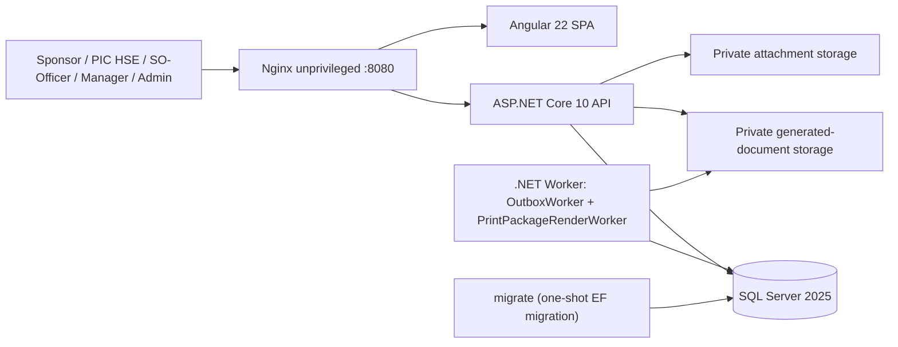
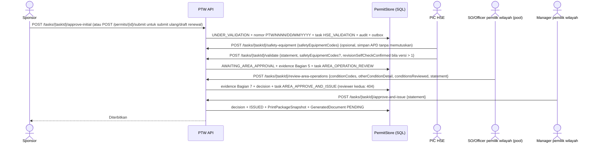
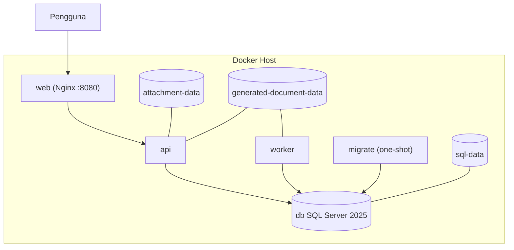

# Functional Specification Document (FSD)
## Nusantara Regas Permit to Work Online

| Atribut | Nilai |
| --- | --- |
| Versi | 1.8 — penyelarasan flow dengan sistem berjalan: review Bagian 7 SO/Officer, pembagian pengisian formulir, renewal dan closure berbasis hardcopy terverifikasi |
| Tanggal | 25 September 2026; Amendemen 1: 21 Oktober 2026 (lihat Bagian 0.1) |
| Status | Disahkan sebagai baseline 25 September 2026; diamendemen 21 Oktober 2026 mengikuti UAT-2026-10-12, HSE-SPONSOR-SELF-VALIDATION, dan REQUESTER-PELAKSANA-SIGNATURE |
| Input | [BRD v1.8](BRD-NR-PTW-Online-v1.8-ID.md), [PRD v1.8](PRD-NR-PTW-Online-v1.8-ID.md) |
| Menggantikan | FSD v1.7 (16 September 2026) |
| Arsitektur | Modular monolith, REST API, SPA, asynchronous worker |
| Platform | ASP.NET Core 10 / .NET 10 LTS; Angular 22; SQL Server 2025; Docker Compose V2 |

## 0. Ringkasan perubahan v1.8

| Area FSD | Perubahan |
| --- | --- |
| State machine (Bagian 5) | Command `ReviewAreaOperations` (task `AREA_OPERATION_REVIEW`) ditambahkan di antara `ValidateSubmission` dan `ApproveAndIssuePermit`; `RequestRenewal` tidak lagi membuat draft, tetapi evidence review pada PTW asal; `ApproveRenewal` membuat draft penerus; `ResubmitClosure` dan verifikasi Bagian 10 pada `ClosePermit`; `EscalateValidation` tanpa transisi. |
| Task workflow | Tipe task resmi: `SPONSOR_INITIAL_APPROVAL`, `REQUESTER_INITIAL_REVISION` (keduanya sejak UAT-2026-10-12), `HSE_VALIDATION`, `SPONSOR_REVISION`, `AREA_OPERATION_REVIEW`, `AREA_APPROVE_AND_ISSUE`, `AREA_RENEWAL_REVIEW`, `AREA_CLOSE_VERIFICATION`. Task terikat versi PTW exact; `AssignedActorId` untuk penugasan langsung. |
| Domain formulir | Katalog terkontrol `PermitHeaderClassificationCatalog`, `PermitWorkTypeCatalog`, `PermitSupportingDocumentCatalog`, `PermitMandatoryDocumentCatalog`, `PermitSafetyEquipmentCatalog`, `PermitOperationalConditionCatalog`; evidence `PermitValidationEvidence` (Bagian 5), `AreaOperationsReviewEvidence` (Bagian 7), `PermitApprovalEvidence`. |
| Identitas | Akun lokal (`sec.UserAccount`, `sec.UserCredential`, `sec.UserSignatureVersion`), cookie HTTP-only Development, profil role `UserAuthorizationRoleProfiles`, assignment langsung dengan action code turunan server. |
| Paket cetak | Renderer PDFsharp dua halaman A3 di atas template vektor FM-001/002/003-B-002-NR-B220; `SponsorPrintEvidence` dan `VisualSignatureEvidence` dibekukan ke snapshot; QR/kampanye keluar dari scope. |
| API | Endpoint aktual `/api/v1` (Bagian 8.2) menggantikan daftar endpoint rencana v1.7. |
| Data | Schema aktual (`ptw`, `wf`, `doc`, `sec`, `cfg`, `intg`, `audit`) dan migration additive sampai `BackfillSponsorRevisionTasks` (per 25 September 2026; daftar terkini pada Bagian 19). |

## 0.1 Amendemen pasca-v1.8 (21 Oktober 2026)

Record berikut disahkan setelah baseline 25 September 2026 dan telah diimplementasikan; bila teks tubuh FSD bertentangan, record ini yang berlaku (DEC-129 sampai DEC-131 pada BRD Bagian 2.2):

| Record | Dampak pada FSD |
| --- | --- |
| [UAT-2026-10-12](decisions/UAT-2026-10-12.md) / [PTW-WORKFLOW-BASELINE Amendemen 3](decisions/PTW-WORKFLOW-BASELINE.md) (12 dan 20 Oktober 2026) | E-SIMI dihapus (Bagian 10 FSD, `ESimiExternalId`/`ESimiNumber`, kode `ESIMI`); command inisiasi `SubmitInitiation`/`ApproveInitiation`/`ReturnInitiation`/`RejectInitiation` dan `SaveSafetyEquipmentSelection` (Bagian 5.1, 8.2); role `Requester` dan `PermitInitiation`/`ptw.Permit.InitiatedBy`; nomor `PTW/NNNN/DD/MM/YYYY` dari `ptw.PermitNumberSequence`; Bagian 9 `PermitWorkCompletionDeclaration` pada closure dan `IncompleteWorkStatus` pada close; halaman 2 paket cetak hanya Bagian 8, blok pengingat HSSE, label `Sertifikat Pekerja`; PJS via `Delegation`/`acting_role`; self check revisi Sponsor dan PIC HSE; `HseSafetyEquipmentSelection`; `GET /reference-data/attachment-policy`, `GET /sponsors`, pratinjau lampiran dengan CSP `blob:` |
| [HSE-SPONSOR-SELF-VALIDATION](decisions/HSE-SPONSOR-SELF-VALIDATION.md) (20 Oktober 2026) | Guard `aktor ≠ Sponsor` pada `ValidateSubmission` dan `SaveSafetyEquipmentSelection` dihapus (`permit.validation.self_validation_forbidden` tidak ada lagi); SoD review Bagian 7 dan penerbitan tetap |
| [REQUESTER-PELAKSANA-SIGNATURE](decisions/REQUESTER-PELAKSANA-SIGNATURE.md) (21 Oktober 2026) | `RequesterPrintEvidence` pada `PrintPackageSnapshotPayload.Requester`; overlay `RequesterSignature`/`RequesterSignedAt` pada slot Pelaksana Pekerjaan Bagian 3; `RendererVersion` `ptw-form-renderer/4.2.0` |
| [OPN-007](decisions/OPN-007.md), kontrak Portal dua langkah (diverifikasi live 30 September 2026) | `PortalApiDirectoryAuthenticator`: `SecureAuth` (kredensial service → bearer) lalu `ADAuth` (bearer, kredensial pengguna pada query, hasil boolean); `PortalAuth:ServiceUserName`/`ServicePassword` wajib saat aktif |

## 1. Tujuan dan batas spesifikasi

FSD ini menjelaskan bagaimana requirement PTW diwujudkan secara fungsional dan teknis pada sistem yang berjalan, serta menandai bagian yang masih backlog. Dokumen ini bukan pengganti SOP dan tidak menetapkan nilai ambang keselamatan yang belum disahkan. Pada rilis awal ORF, Site Office, dan Water-Based Activity, sistem mengelola pengajuan sampai penerbitan, renewal, dan penutupan, sedangkan gas test, revalidasi harian, dan tanda tangan lapangan dilakukan pada hardcopy yang dihasilkan sistem.

## 2. Keputusan arsitektur

| ADR | Keputusan | Alasan / konsekuensi |
| --- | --- | --- |
| ADR-001 | Modular monolith | Scope NR lebih kecil; transaksi lintas domain lebih sederhana. Batas modul ditegakkan lewat arah dependency `Api`/`Worker` → `Application` → `Domain`/`Contracts`; `Infrastructure` mengimplementasikan port. |
| ADR-002 | Angular SPA + ASP.NET Core API | Pemisahan UI/API, ProblemDetails, dan kontrak OpenAPI Development. |
| ADR-003 | SQL Server sebagai source of truth PTW | Konsistensi transaksi, rowversion, referential integrity. |
| ADR-004 | Dihapus (UAT-2026-10-12 no. 1) | PTW tidak terhubung dengan E-SIMI: tidak ada referensi, lampiran, adapter, maupun shared database. |
| ADR-005 | Synchronous core, asynchronous side effects | State + task + audit + outbox + idempotency commit atomik; render PDF diproses Worker. |
| ADR-006 | Explicit state machine | Tidak ada perubahan status generik; setiap command memiliki guard, policy, transaksi, audit, dan event. |
| ADR-007 | Docker Compose Specification | Environment konsisten; produksi single-host menerima batas HA. |
| ADR-008 | Katalog formulir terkontrol sebagai transkripsi template | Katalog statis di `Ptw.Domain` menjadi otoritas isi Bagian 1/4/5/7 sampai master effective-dated OPN-003 disahkan; perubahan hanya via decision record. |
| ADR-009 | Hybrid digital-to-paper field execution | Bagian pengajuan/keputusan digital; Bagian 6 dan 8 pada hardcopy; Bagian 9 (Sponsor) dan 10 (Pemilik Wilayah) digital sejak UAT-2026-10-12; renewal dan close merekonsiliasi hardcopy ke paket cetak resmi. |
| ADR-010 | Immutable print snapshot + asynchronous rendering | Approval mengunci snapshot; Worker merender; retry tidak mengubah keputusan; paket `READY` immutable. |
| ADR-011 | Location release server-side | Konfigurasi `LocationRelease:AreaOwnerDepartments` menentukan lokasi aktif dan departemen pemilik; lokasi lain fail-closed. |
| ADR-012 | Gate berurutan dengan SoD | `SPONSOR_INITIAL_APPROVAL` (di dalam `DRAFT`) → `HSE_VALIDATION` → `AREA_OPERATION_REVIEW` → `AREA_APPROVE_AND_ISSUE`, masing-masing pada versi PTW exact; reviewer Bagian 7 dan Manager penerbit harus berbeda dari Sponsor dan validator HSE, sedangkan Sponsor yang memegang `HSEValidator` boleh memvalidasi PTW-nya sendiri (HSE-SPONSOR-SELF-VALIDATION). |
| ADR-013 | Identitas melalui Portal API dengan fallback lokal (OPN-007 bagian 1) | `PortalApiDirectoryAuthenticator` memverifikasi kredensial ke Portal API dua langkah (kredensial service → bearer dari `SecureAuth`; bearer mengotorisasi `ADAuth` yang memeriksa kredensial pengguna terhadap Active Directory dan menjawab boolean; bearer tidak disimpan), fallback ke password akun lokal; cookie HTTP-only dengan security stamp; role/scope dihitung ulang per request dari assignment approved/effective; di luar Development login dibuka lewat `Authentication:LoginEnabled` dengan Portal https (atau opt-in http internal eksplisit). |

## 3. System context dan container



### 3.1 Container responsibility

| Container/service | Tanggung jawab | Scale awal |
| --- | --- | --- |
| `web` | Nginx unprivileged: static SPA, reverse proxy `/api` dan `/health`, header keamanan/CSP, cache `index.html` revalidasi, aset hash immutable, chunk hilang `404` | 1 |
| `api` | REST API, authentication (cookie lokal/dev header), authorization, domain commands/queries, upload/download, health, OpenAPI Development | 1 |
| `worker` | `OutboxWorker` (dispatch outbox, idle 5 detik) dan `PrintPackageRenderWorker` (claim job `PENDING`/`RETRYING`, render, backoff eksponensial 2^n menit maksimum 30, `FAILED` setelah `MaxRenderAttempts`) | 1 |
| `db` | SQL Server 2025 | 1 |
| `migrate` | One-shot EF Core migration sebelum `api`/`worker` | Per deployment |

## 4. Struktur solusi dan modul

```text
src/Ptw.Domain          Permit aggregate, PermitStatus, katalog formulir, evidence records, UserAccount, UserAuthorizationAssignment, LocationMasterEntry
src/Ptw.Contracts       DTO request/response
src/Ptw.Application     PermitService, PermitAttachmentService, PrintPackageService, UserAuthorizationService, UserDirectoryService, LocationMasterService, OperationalPolicy, ports
src/Ptw.Infrastructure  PtwDbContext + stores, AttachmentStorage, GeneratedDocumentStorage, Printing/ (PtwFormRenderer, PrintTemplateDescriptor, overlay template PDF, font embedded)
src/Ptw.Api             Controllers tipis, ApiExceptionHandler, Security/ (DevelopmentAuthenticationHandler, HttpActorContext), rate limiter
src/Ptw.Worker          OutboxWorker, PrintPackageRenderWorker
src/web                 Angular: core/*-api.ts + features/{login,dashboard,permits,tasks,admin}
tests/                  Ptw.Domain.Tests, Ptw.Api.IntegrationTests (Testcontainers), Ptw.Printing.Tests
```

Modul fungsional: (1) Identity & Authorization, (2) Permit & katalog formulir, (3) Attachments & evidence, (4) Workflow tasks & decisions, (5) Issuance & print package, (6) Suspension, renewal, closure, (7) Location master & policy readiness, (8) Audit & outbox.

## 5. Spesifikasi state machine

### 5.1 Transition matrix

| Command | Dari | Ke | Aktor (role) | Guard utama |
| --- | --- | --- | --- | --- |
| `CreateDraft` | — | DRAFT | `Requester` (Pemohon; Sponsor tanpa role ini `403`) atau `Administrator` | Field wajib termasuk Sponsor NR terpilih (`PermitInitiation`, `InitiatedBy` = Pemohon); tipe pengaju `CONTRACTOR`/`USER_SPONSOR`; validity ≤ 7 hari; katalog jenis pekerjaan valid; payload Bagian 5 ditolak |
| `UpdateDraft` | DRAFT/REVISION_REQUIRED | sama | Pemohon inisiator (saat `DRAFT` sebelum persetujuan) atau Sponsor pemilik | `If-Match`; normalisasi katalog; `ChangeSequence` naik, versi bisnis tetap |
| `AddAttachment`/`RemoveAttachment` | DRAFT/REVISION_REQUIRED (`SIGNED_FIELD_COPY`: ISSUED/SUSPENDED/EXPIRED/tindak lanjut closure) | sama | Pemohon inisiator atau Sponsor pemilik | Kategori, kode dokumen, metadata, scan; terkunci saat review renewal `PENDING` |
| `SubmitInitiation` | DRAFT | DRAFT | Pemohon inisiator (`Requester`) | `POST /permits/{id}/initial-submit`; kelengkapan draft dan lampiran seperti submit; `SubmittedToSponsorAt` dicatat; membuat satu task `SPONSOR_INITIAL_APPROVAL` dengan `AssignedActorId` = Sponsor terpilih; audit `permit_initial_submitted` |
| `ApproveInitiation` | DRAFT | UNDER_VALIDATION | Sponsor yang ditugaskan | `POST /tasks/{taskId}/approve-initial`; `requirementsConfirmed=true`; komentar; menjalankan guard `SubmitPermit` (nomor resmi dialokasikan, task `HSE_VALIDATION`) dalam transaksi yang sama; inisiasi berstatus `Approved`; audit `permit_initial_approved` |
| `ReturnInitiation` | DRAFT | DRAFT | Sponsor yang ditugaskan | `POST /tasks/{taskId}/return-initial`; alasan; task `SPONSOR_INITIAL_APPROVAL` selesai; satu task `REQUESTER_INITIAL_REVISION` untuk Pemohon; siklus kembalikan–ajukan ulang boleh berulang pada versi draft yang sama (index unik task hanya pada `PENDING`); audit `permit_initial_returned` |
| `RejectInitiation` | DRAFT | REJECTED | Sponsor yang ditugaskan | `POST /tasks/{taskId}/reject-initial`; alasan; terminal tanpa nomor PTW; task tertunda dibatalkan; audit `permit_initial_rejected` |
| `SubmitPermit` | DRAFT (draft renewal) / REVISION_REQUIRED | UNDER_VALIDATION | Sponsor pemilik | Lokasi released; header klasifikasi lengkap; detail `Lain-lain`; JSA dan Prosedur Pekerjaan dipilih; evidence JSA/Prosedur Pekerjaan/ID/BPJS TK/FTW dan setiap pilihan Bagian 4; metadata JSA cocok; nomor resmi `PTW/NNNN/DD/MM/YYYY` dialokasikan dari `ptw.PermitNumberSequence` (`UPDLOCK, HOLDLOCK` pada baris tahun) di transaksi yang sama pada submit pertama; dari `REVISION_REQUIRED` wajib `revisionSelfCheckConfirmed=true` (`permit.submit.revision_self_check_required`); evidence review dihapus, `HseSafetyEquipmentSelection` dipertahankan; resubmit menaikkan versi; membuat satu task `HSE_VALIDATION`; menyelesaikan `SPONSOR_REVISION` |
| `SaveSafetyEquipmentSelection` | UNDER_VALIDATION | UNDER_VALIDATION | `HSEValidator` | `POST /tasks/{taskId}/safety-equipment`; task `HSE_VALIDATION` aktif; ≥ 1 kode Bagian 5 valid; menyimpan `HseSafetyEquipmentSelection` tanpa memutuskan validasi; audit `hse_safety_equipment_saved` |
| `ValidateSubmission` | UNDER_VALIDATION | AWAITING_AREA_APPROVAL | `HSEValidator` (boleh Sponsor PTW yang sama, HSE-SPONSOR-SELF-VALIDATION) | Task `HSE_VALIDATION` aktif pada versi sama; pernyataan; ≥ 1 kode Bagian 5 valid per kelas (payload kosong memakai pilihan tersimpan); versi > 1 wajib `revisionSelfCheckConfirmed=true` (`permit.validation.revision_self_check_required`); membuat satu task `AREA_OPERATION_REVIEW` |
| `EscalateValidation` | UNDER_VALIDATION | UNDER_VALIDATION | `HSEValidator` | Catatan wajib; audit/event tanpa perubahan status |
| `RequestRevision` | UNDER_VALIDATION/AWAITING_AREA_APPROVAL | REVISION_REQUIRED | Role sesuai task aktif (`HSEValidator`, `AreaOwnerSeniorOfficer`, `AreaOwnerManager`) | Alasan; evidence Bagian 5/7/approval dihapus; task tertunda dibatalkan; satu task `SPONSOR_REVISION` dengan `AssignedActorId` = Sponsor |
| `RejectPermit` | UNDER_VALIDATION/AWAITING_AREA_APPROVAL | REJECTED | Role sesuai task aktif | Alasan; task tertunda dibatalkan |
| `ReviewAreaOperations` | AWAITING_AREA_APPROVAL | AWAITING_AREA_APPROVAL | `AreaOwnerSeniorOfficer` dengan scope lokasi | Task `AREA_OPERATION_REVIEW` aktif; validasi HSE ada; belum direview; aktor ≠ Sponsor/validator; `ConditionsReviewed=true`; kode Bagian 7 valid (parent/child, detail `Lainnya` ≤ 200); assignment terverifikasi; nama/jabatan dari profil; decision `AREA_OPERATION_REVIEW`; membuat satu task `AREA_APPROVE_AND_ISSUE` |
| `ApproveAndIssuePermit` | AWAITING_AREA_APPROVAL | ISSUED | `AreaOwnerManager` dengan scope lokasi | Task `AREA_APPROVE_AND_ISSUE` aktif; validasi HSE + Bagian 5 + review Bagian 7 ada; aktor ≠ Sponsor/validator/reviewer; `IssuancePolicy` ready; kapasitas PJS ditentukan server dari assignment `Delegation` (claim `acting_role`; evidence `ActingForManager` + `ActingAssignmentId` + principal, payload klien diabaikan); assignment terverifikasi; `now ≤ ValidUntil`; commit decision + `ISSUED` + `PrintPackageSnapshot` + `GeneratedDocument PENDING` |
| `SuspendPermit` | ISSUED | SUSPENDED | `HSEValidator`/`AreaOwnerManager`/`Administrator` | Alasan; scope lokasi |
| `ResolveSuspension` | SUSPENDED | ISSUED | `AreaOwnerManager`/`Administrator` | Resolusi; event menandai `RequiresHardcopyRevalidation` |
| `RequestRenewal` | ISSUED/EXPIRED | sama | Sponsor pemilik | Belum ada closure; belum ada penerus; tidak ada review `PENDING`; evidence berbeda bila sebelumnya `RevisionRequired`; PrintPackage `READY` milik PTW; `SIGNED_FIELD_COPY` `CLEAN`, aktif, tidak superseded, bermetadata, cocok versi/paket; `ValidFrom ≥ ValidUntil asal`; durasi ≤ 7 hari; versi naik; membuat task `AREA_RENEWAL_REVIEW` |
| `RequestRenewalEvidenceReplacement` | ISSUED/EXPIRED | sama | `AreaOwnerManager` | Review `PENDING`; alasan; status review → `RevisionRequired`; task selesai |
| `RejectRenewal` | ISSUED/EXPIRED | sama | `AreaOwnerManager` | Review `PENDING`; alasan; status review → `Rejected` |
| `ApproveRenewal` | ISSUED/EXPIRED | sama (+ penerus DRAFT) | `AreaOwnerManager` | Review `PENDING`; `FieldVerificationConfirmed` dan `EvidenceReadable`; evidence dicek ulang; draft penerus dibuat atomik dengan Sponsor/lokasi sama, periode yang diminta, tanpa lampiran/Bagian 5; `RenewalPermitId` diisi |
| `RequestClosure` | ISSUED/SUSPENDED/EXPIRED | CLOSURE_REQUESTED | Sponsor pemilik | Tidak ada penerus atau review renewal aktif; PrintPackage `READY`; `SIGNED_FIELD_COPY` valid seperti renewal; pernyataan penyelesaian; Bagian 9 `PermitWorkCompletionDeclaration` wajib (`WorkCompleted`, `EquipmentAndMaterialsRemoved`, `Explanation`, `PerformingAuthorityName`, `PerformingAuthorityBadgeNumber`, `SponsorBadgeNumber`) dan masuk audit; membuat task `AREA_CLOSE_VERIFICATION` |
| `RequestClosureEvidenceReplacement` | CLOSURE_REQUESTED | CLOSURE_REQUESTED | `AreaOwnerManager`/`AreaOwnerSeniorOfficer` dengan scope lokasi | Belum ada tindak lanjut tertunda; alasan; revisi naik; task selesai |
| `ResubmitClosure` | CLOSURE_REQUESTED | CLOSURE_REQUESTED | Sponsor pemilik | Tindak lanjut sedang diminta; PrintPackage sama; evidence berbeda dan valid; Bagian 9 wajib ulang; task `AREA_CLOSE_VERIFICATION` baru mengikuti versi |
| `ClosePermit` | CLOSURE_REQUESTED | CLOSED | `AreaOwnerManager`/`AreaOwnerSeniorOfficer` dengan scope lokasi | Satu task pool dimenangkan aktor pertama; tidak ada tindak lanjut tertunda; nama Officer ≤ 100; konfirmasi Bagian 10 dan pernyataan; bila Bagian 9 menyatakan belum selesai, `IncompleteWorkStatus` wajib dan `WorkCompleted=true` ditolak (`permit.closure.completion_mismatch`); closure legacy tanpa Bagian 9 memakai jalur selesai; Bagian 9/10 masuk audit `permit_closed` |
| `CancelPermit` | DRAFT/UNDER_VALIDATION/REVISION_REQUIRED | CANCELLED | Sponsor pemilik | Alasan; task tertunda dibatalkan |
| `ExpirePermit` | ISSUED/SUSPENDED | EXPIRED | `Administrator` (manual) | `now ≥ ValidUntil`; otomatisasi Worker backlog |

### 5.2 Invariant domain

- satu Permit mempunyai satu versi aktif; setiap submit ulang menaikkan versi;
- nomor resmi `PTW/NNNN/DD/MM/YYYY` (urutan reset per tahun kalender WIB, tanggal submit WIB) dialokasikan saat submit pertama di dalam transaksi dan tidak berubah; nomor tidak dipakai ulang dan nomor legacy `PTW-YYYYMMDD-XXXX` tidak diubah;
- alur inisial Pemohon → Sponsor berjalan di dalam `DRAFT` sebagai task, bukan status baru; `RejectInitiation` adalah satu-satunya jalur `DRAFT` → `REJECTED`;
- `CLOSED`, `REJECTED`, `CANCELLED`, `EXPIRED` terminal; `EXPIRED` masih dapat menjadi sumber renewal/closure;
- setiap transition, task, decision, audit event, outbox message, dan idempotency receipt berada dalam satu transaksi;
- command wajib membawa `If-Match` dan `Idempotency-Key`;
- submit membuat tepat satu `HSE_VALIDATION`; validasi membuat tepat satu `AREA_OPERATION_REVIEW`; review membuat tepat satu `AREA_APPROVE_AND_ISSUE`; unique index `(PermitId, BusinessPermitVersion, Type)` pada task `PENDING` mencegah duplikasi;
- `RequestRevision` menghapus `HseValidation`, `AreaOperationsReview`, `Approval`, dan Bagian 5 pada evidence validasi, tetapi mempertahankan `HseSafetyEquipmentSelection` yang disimpan PIC HSE;
- Sponsor yang memegang `HSEValidator` boleh memvalidasi PTW-nya sendiri (HSE-SPONSOR-SELF-VALIDATION); Sponsor/validator tidak dapat mereview; Manager penerbit berbeda dari Sponsor, validator, dan reviewer;
- Bagian 5 hanya melalui `ValidateSubmission`; payload draft yang membawa Bagian 5 ditolak (`permit.safety_equipment.hse_owned`);
- Bagian 7 hanya melalui `ReviewAreaOperations`; approval tanpa review ditolak (`permit.area_operations.review_required`);
- pemilik wilayah diturunkan dari `LocationRelease`; lokasi tanpa release ditolak (`permit.location.not_released`);
- `PrintPackageSnapshot` memakai versi PTW exact, decision, `RuleVersion`, `PrintTemplateVersion`, `CampaignAssetVersion`, dan `SponsorPrintEvidence`; unique per `(PermitId, PermitVersion)`;
- paket `READY` immutable; preview selalu ber-watermark dan tidak disimpan;
- renewal dan closure saling eksklusif (`permit.renewal.closure_conflict`, `permit.closure.renewal_conflict`); satu PTW asal hanya satu penerus (`permit.renewal.already_requested`);
- `SIGNED_FIELD_COPY` untuk renewal/closure harus `CLEAN`, aktif, tidak superseded, bermetadata lengkap, dan cocok `TargetPermitVersion`/`PrintPackageId` dengan paket `READY`;
- `ISSUED` tidak merepresentasikan revalidasi harian.

## 6. Desain use case utama

### UC-01 Membuat, mengajukan ke Sponsor, dan submit PTW

**Precondition:** Pemohon (`Requester`) authenticated; lokasi termasuk release aktif; Sponsor NR tersedia (`GET /api/v1/sponsors`).

1. Pemohon membuat draft: Sponsor NR terpilih, judul, uraian, lokasi, kelas izin, tipe pengaju, perusahaan, pelaksana, masa berlaku, klasifikasi header, jenis pekerjaan Bagian 1 (+ detail `Lain-lain`), Bagian 2 (equipment tag/nama, Work Order No., plant/area, referensi bahaya tambahan), pilihan Bagian 4, dan metadata JSA. Identitas aktor diambil dari `/api/v1/me`; `Permit.Initiation` merekam Pemohon (`InitiatedBy`).
2. Pemohon mengunggah lampiran multipart dengan `category` (`SUPPORTING`/`JSA`) dan `supportingDocumentCode` (`JSA`, `ID`, `BPJS_TK`, `FTW`, atau kode Bagian 4) lewat tombol unggah per dokumen; batas ukuran/jumlah/format dari `GET /api/v1/reference-data/attachment-policy`; lampiran `CLEAN` dapat dipratinjau. JSA membawa nomor/revisi/tanggal. Halaman lampiran menampilkan kesiapan dokumen dasar dan pilihan Bagian 4.
3. `POST /permits/{id}/initial-submit` memverifikasi kelengkapan yang sama dengan submit, mencatat `SubmittedToSponsorAt`, dan membuat task `SPONSOR_INITIAL_APPROVAL` untuk Sponsor terpilih; status tetap `DRAFT`.
4. Sponsor mengedit draft bila perlu, lalu `POST /tasks/{taskId}/approve-initial` (`requirementsConfirmed`, komentar): API memverifikasi release lokasi, kelengkapan katalog, evidence per dokumen, kecocokan metadata JSA, dan status scan; mengalokasikan nomor `PTW/NNNN/DD/MM/YYYY` dari `ptw.PermitNumberSequence`; membuat `HSE_VALIDATION`; semuanya dalam satu transaksi. Alternatif: `return-initial` (task `REQUESTER_INITIAL_REVISION`, kembali ke langkah 1) atau `reject-initial` (`REJECTED`).
5. Submit ulang setelah `REVISION_REQUIRED` memakai `POST /permits/{id}/submit` oleh Sponsor dengan `revisionSelfCheckConfirmed=true`; menghapus evidence review (pilihan APD tersimpan dipertahankan), menaikkan versi, mempertahankan nomor, membuat `HSE_VALIDATION`, menyelesaikan `SPONSOR_REVISION`.
6. Respons berisi status `UNDER_VALIDATION`, nomor, versi, dan ETag baru.

**Failure:** `409` versi/idempotency, `422` validasi katalog/evidence (`permit.mandatory_document.evidence_required`, `permit.supporting_document.jsa_metadata_mismatch`, `permit.header_classification_required`, `permit.submit.revision_self_check_required`), `403` scope/kepemilikan (Pemohon di luar `InitiatedBy`, Sponsor tanpa `Requester` pada `POST /permits`).

### UC-02 Validasi HSE, review Bagian 7, dan approval



Task pool dirutekan berdasarkan `RequiredRole` dan scope lokasi aktor; task dengan `AssignedActorId` terlihat oleh identitas tersebut. Nama dan jabatan aktor pada evidence diambil dari `UserDirectoryStore` (profil akun aktif); jabatan default per lokasi hanya dipakai bila profil tidak memuat jabatan. Spesimen tanda tangan aktif dibekukan (`VisualSignatureEvidence`: versi, media type, byte, SHA-256).

### UC-03 Approval penerbitan dan paket cetak

`ApproveAndIssuePermit` menjalankan seluruh guard dan dalam satu transaksi menyimpan `wf.Decision` (kapasitas `Manager` atau `ActingForManager` bila aktor memegang role hanya lewat assignment `Delegation`), status `ISSUED`, `doc.PrintPackageSnapshot` (JSON `PrintPackageSnapshotPayload` termasuk draft, Bagian 5, Bagian 7, approval, `SponsorPrintEvidence`, dan `RequesterPrintEvidence` bila PTW diinisiasi Pemohon), `doc.GeneratedDocument` `PENDING`, audit, dan outbox. `PrintPackageRenderWorker` mengklaim job, merender dua halaman A3 dari snapshot, menyimpan file privat, dan menandai `READY` dengan SHA-256 dan `RendererVersion`. Kegagalan memberi `RETRYING` dengan backoff atau `FAILED`; Administrator dapat `POST .../retry` idempotent. Unduhan hanya untuk `READY` dan menghasilkan audit event.

### UC-04 Suspend dan resume

`SuspendPermit` oleh PIC HSE/Manager/Administrator merekam alasan, aktor, waktu. `ResolveSuspension` oleh Manager/Administrator mengembalikan `ISSUED` dengan event `RequiresHardcopyRevalidation=true`; UI menampilkan peringatan revalidasi hardcopy.

### UC-05 Renewal berbasis review pemilik wilayah

1. Sponsor mengunggah `SIGNED_FIELD_COPY` hasil verifikasi lapangan dengan `printPackageId`, nomor/revisi/tanggal.
2. `POST /permits/{id}/renew` dengan `printPackageId`, `signedFieldCopyAttachmentIds`, `continuationStatement`, `validFrom`, `validUntil`. Domain menyimpan `PermitRenewalRequestEvidence` (`Pending`, revisi ke-n), menaikkan versi, dan store membuat task `AREA_RENEWAL_REVIEW` untuk `AreaOwnerManager`.
3. Manager: `request-evidence` (status `RevisionRequired`; Sponsor wajib mengajukan lagi dengan evidence berbeda), `reject` (`Rejected`), atau `approve` (`fieldVerificationConfirmed`, `evidenceReadable`, `statement`).
4. Pada approve, service memverifikasi ulang evidence, membuat `Permit.CreateRenewal` dari draft asal dengan periode yang diminta dan Bagian 5 kosong, memanggil `ApproveRenewal` (memeriksa Sponsor/lokasi/periode cocok), lalu `AddRenewalAsync` menyimpan PTW asal dan penerus atomik. Respons memuat versi/ETag PTW asal dan detail penerus.
5. Penerus `DRAFT` menjalani UC-01 sampai UC-03.

### UC-06 Upload hardcopy dan close

1. Sponsor mengunggah `SIGNED_FIELD_COPY` untuk paket `READY`, lalu `POST /permits/{id}/closure-requests` dengan `printPackageId`, `signedFieldCopyAttachmentIds`, `completionStatement`, dan `completion` (Bagian 9: `workCompleted`, `equipmentAndMaterialsRemoved`, `explanation`, `performingAuthorityName`, `performingAuthorityBadgeNumber`, `sponsorBadgeNumber`). Status `CLOSURE_REQUESTED`; task `AREA_CLOSE_VERIFICATION`; payload audit `closure_requested` memuat `section9`.
2. Manager atau SO/Officer membuka task, membandingkan evidence dengan paket cetak, lalu:
   - `close` dengan `officerName`, `workAreaInspectedAndClean`, `workCompleted`, `managerAgreesWorkCompleted`, `inhibitedSystemsRestored`, `areaHandedBackAndSafeguardsRestored`, `evidenceReadable`, `statement`, dan `incompleteWorkStatus` (wajib bila Bagian 9 menyatakan belum selesai; `workCompleted=true` saat itu ditolak dengan `permit.closure.completion_mismatch`) → `CLOSED`; atau
   - `request-evidence` dengan alasan → `ReplacementReason` terisi, revisi naik, close terkunci.
3. Sponsor mengunggah hardcopy pengganti (kategori `SIGNED_FIELD_COPY` diizinkan saat tindak lanjut diminta) dan `POST /permits/{id}/closure-requests/resubmit` dengan paket yang sama, attachment berbeda, dan Bagian 9 ulang; task `AREA_CLOSE_VERIFICATION` baru mengikuti versi; status tetap `CLOSURE_REQUESTED`.
4. PIC HSE tidak memiliki task; read model menampilkan hasil sesuai scope.

## 7. Katalog formulir dan otorisasi

### 7.1 Katalog formulir terkontrol (Ptw.Domain)

| Katalog | Isi | Aturan |
| --- | --- | --- |
| `PermitHeaderClassificationCatalog` | HOT: `HOT_OPEN_FLAME` Api Terbuka, `HOT_SPARK` Percikan Api; COLD: `COLD_LOW_RISK`, `COLD_HIGH_RISK`; CSE: kosong | HOT multiple, COLD exclusive (tepat satu; memetakan `RiskLevel` legacy), CSE none; wajib saat submit |
| `PermitWorkTypeCatalog` | Item Bagian 1 per kelas sesuai formulir (HOT 18 item, COLD 23 item, CSE 22 item) dengan indeks posisi template | Minimal satu; `*_OTHER` mewajibkan detail ≤ 80 karakter |
| `PermitSupportingDocumentCatalog` | 15 item Bagian 4 (JSA, Check List Inspeksi Alat Berat, Isolation/De-isolation, Prosedur Pekerjaan, P&ID/Plot Plan, MOC, Clearance Penggalian, Emergency Response Plan, Sertifikat Sea Survival, Ijin Penon-aktifan Sistem Pengaman, Sertifikat Peralatan, Sertifikat Pekerja (label `WORK_CERTIFICATE` sejak UAT-2026-10-12 no. 2), Lifting Plan, Penutupan jalan, MSDS) | JSA dan Prosedur Pekerjaan wajib serta otomatis terpilih; JSA bermetadata; setiap pilihan butuh lampiran bertaut |
| `PermitMandatoryDocumentCatalog` | JSA, Prosedur Pekerjaan, ID, BPJS TK, FTW (kode `ESIMI` dihapus, UAT-2026-10-12 no. 1) | Evidence submit; JSA dan Prosedur Pekerjaan juga dicetak di Bagian 4, tiga evidence lainnya tidak |
| `PermitSafetyEquipmentCatalog` | Item Bagian 5 per kelas (21 item umum; HOT + Whipcheck; CSE + Watch man, Ventilator) | Minimal satu; hanya PIC HSE |
| `PermitOperationalConditionCatalog` | `OPS_ISOLATION` (+ `CLOSED_LOCK_VALVES`, `BLIND`, `DISCONNECT`), `OPS_DEPRESSURIZED`, `OPS_DRAINED`, `OPS_VENTILATED`, `OPS_FLUSHING` (+ `N2_PURGE`, `WATER`), `OPS_OTHER` | Parent wajib bila child dipilih; `Isolasi`/`Bilas` mewajibkan ≥ 1 child; `Lainnya` mewajibkan detail ≤ 200 |

Katalog dibaca klien dari `GET /api/v1/reference-data/{header-classifications|work-types|supporting-documents|mandatory-documents|safety-equipment|operational-conditions}` dan divalidasi ulang server. Rules engine deklaratif dan `RuleEvaluationSnapshot` adalah backlog OPN-003.

### 7.2 Policy authorization

```text
allow = authenticated
     AND role (dari assignment approved/effective) permits command
     AND location scope covers permit ("*" atau LocationId)
     AND (Sponsor commands ⇒ actor == Draft.SponsorId, kecuali Administrator)
     AND task command ⇒ task pending, type sesuai, versi == permit.Version,
         (AssignedActorId == actor OR RequiredRole ∈ roles)
     AND OperationalPolicy gate (Development dan Production saat ini: profil role, EnforceMasterAuthorization=false; master authorization effective-dated adalah backlog OPN-001/002)
     AND (Requester commands ⇒ actor == Permit.InitiatedBy)
     AND separation-of-duty (Sponsor/HSE ≠ SO/Officer; Manager ≠ Sponsor/HSE/SO/Officer;
         Sponsor == HSE diizinkan sejak HSE-SPONSOR-SELF-VALIDATION)
     AND expected ETag matches
```

Profil role (`UserAuthorizationRoleProfiles`) di server menurunkan action code:

| Role | `LocationRequired` | Action code |
| --- | --- | --- |
| `Administrator` | tidak | `admin.manage` |
| `Requester` | tidak | `permit.initial.create`, `permit.initial.update`, `permit.initial.submit` (Pemohon; akun Kontraktor hanya memegang role ini, UAT-2026-10-12 no. 14) |
| `Sponsor` | tidak | `permit.create`, `permit.update`, `permit.submit`, `permit.renewal.request`, `permit.closure.request`, `permit.cancel` (`POST /permits` tetap memerlukan `Requester` atau `Administrator`) |
| `HSEValidator` | tidak | `permit.validate`, `permit.validation.revision`, `permit.validation.reject`, `permit.validation.escalate`, `permit.suspend` |
| `AreaOwnerSeniorOfficer` | ya | `permit.area-operations.review`, `permit.closure.review` |
| `AreaOwnerManager` | ya | `permit.approve-and-issue`, `permit.suspend`, `permit.suspension.resolve`, `permit.renewal.review`, `permit.closure.review` |
| `Auditor` | tidak | `permit.read`, `audit.read` |

Profil ini dipakai Development dan Production sebagai baseline yang disahkan (PTW-WORKFLOW-BASELINE), bukan matriks OPN-002 effective-dated; tanpa profil terkonfigurasi, assignment langsung fail-closed. Frontend hanya menyembunyikan aksi; API selalu mengevaluasi ulang. Query memakai filter scope; attachment dan print package memeriksa parent permit. Scope baca dipisahkan dari scope command oleh `PermitMonitoringAccess`: SO/Officer dan Manager berscope `ORF` membaca PTW lintas lokasi (daftar, detail, lampiran, paket cetak, history, Papan Operasi) sesuai Amendemen 1 PTW-WORKFLOW-BASELINE, sedangkan task pool dan command tetap memakai scope lokasi asli.

`ApproveAndIssuePermit` menentukan kapasitas di server: aktor yang memegang `AreaOwnerManager` hanya melalui assignment berjenis `Delegation` (Administrator membuatnya lewat **Tetapkan PJS** dari assignment Manager sumber, periode wajib, tidak boleh lebih luas dari sumber) memperoleh claim `acting_role` (demo: header `X-Dev-Acting-Roles`) dan keputusan dicatat `ApprovalCapacity=ActingForManager` dengan `ActingAssignmentId` = assignment delegasi dan `PrincipalManagerUserId` = subject assignment sumber; payload `actingAssignmentId` klien diabaikan. Label "PJS Manager Pemilik Wilayah" tampil pada UI dan baris Manager Bagian 7 (UAT-2026-10-12 no. 13). OPN-002 disahkan untuk alur dan SoD baseline (25 September 2026); model pejabat pengganti yang lebih lengkap (dasar dokumen, batas risiko, lifecycle pencabutan) tetap backlog.

### 7.3 Resolver pemilik area

| LocationCode | Nama lokasi | Departemen pemilik (Development) | Status |
| --- | --- | --- | --- |
| `ORF` | ORF | Departemen Distribusi Gas dan Pengelolaan ORF | aktif |
| `SITE_OFFICE` | Site Office | Departemen General Affair | aktif |
| `WATER_BASED` | Water-Based Activity | Departemen Transport & Operasi FSRU | aktif |
| `HO`, `FSRU`, lainnya | — | — | `permit.location.not_released` |

Konfigurasi dasar (`appsettings.json`) tidak merilis lokasi apa pun; `appsettings.Development.json` dan `appsettings.Production.json` merilis `ORF`, `SITE_OFFICE`, dan `WATER_BASED` dengan departemen pemiliknya. Master lokasi effective-dated (`cfg.LocationMaster*`) tersedia dengan maker-checker, tetapi routing task memakai scope lokasi assignment; `LocationRelease`/`ConfigurationBundle` sebagai tabel adalah backlog.

## 8. Desain API

### 8.1 Konvensi

- Base path `/api/v1`; JSON camelCase; UTC ISO-8601.
- Authentication: cookie HTTP-only dari `POST /api/v1/auth/login` (Portal API dua langkah `SecureAuth` → `ADAuth`, lalu fallback lokal; di luar Development dibuka oleh `Authentication:LoginEnabled`) atau header identitas Development saat mode demo aktif.
- `X-Correlation-ID`, `Idempotency-Key` (wajib pada command, ≤ 200 karakter), `ETag`/`If-Match`.
- Error `application/problem+json` dengan `code` bertitik (`permit.*`, `attachment.*`, `authorization.*`, `task.*`) dari `ApiExceptionHandler`.
- List terpaginasi `offset`/`limit` (1–100).
- Rate limiter fixed window global; OpenAPI (`/openapi/v1.json`) hanya Development.

### 8.2 Endpoint inti (aktual)

| Method/path | Fungsi |
| --- | --- |
| `POST /auth/login`, `POST /auth/logout` | Login/logout akun lokal (Development) |
| `GET /me` | Identitas, role efektif, scope lokasi |
| `GET /locations` | Lokasi yang dapat dipilih |
| `GET /reference-data/*` | Katalog formulir (Bagian 7.1) dan `GET /reference-data/attachment-policy` (ukuran maksimum per file, jumlah maksimum, format) |
| `GET /sponsors` | Daftar Sponsor NR untuk Pemohon (hanya `Requester`/`Sponsor`/`Administrator`) |
| `GET /permits?search=&offset=&limit=`, `GET /permits/{id}` | Daftar terpaginasi (limit 1–100, count total, filter scope baca sebelum pencarian dan `Skip`/`Take`) dan detail scoped; Pemohon hanya melihat PTW `InitiatedBy` miliknya |
| `GET /permits/{id}/activity`, `GET /permits/{id}/versions` | Riwayat audit dan versi |
| `POST /permits` | Buat draft (hanya `Requester` atau `Administrator`) |
| `PATCH /permits/{id}/draft` | Simpan draft dengan `If-Match` |
| `GET/POST /permits/{id}/attachments`, `GET .../{aid}/content`, `POST .../{aid}/remove` | Lampiran multipart dengan kategori dan kode dokumen; unduh hanya `CLEAN` (juga dipakai pratinjau PDF/JPEG/PNG di aplikasi); penghapusan logis |
| `POST /permits/{id}/initial-submit` | Pemohon mengajukan PTW awal ke Sponsor (task `SPONSOR_INITIAL_APPROVAL`) |
| `POST /tasks/{taskId}/approve-initial`, `/return-initial`, `/reject-initial` | Sponsor menyetujui (sekaligus submit ke PIC HSE dengan nomor resmi), mengembalikan (task `REQUESTER_INITIAL_REVISION`), atau menolak (`REJECTED`) PTW awal |
| `POST /permits/{id}/submit` | Submit ulang Sponsor setelah revisi (wajib `revisionSelfCheckConfirmed`) dan submit draft renewal |
| `GET /tasks` | Daftar task (pool + penugasan langsung) |
| `POST /tasks/{taskId}/safety-equipment` | PIC HSE menyimpan pilihan APD Bagian 5 tanpa memutuskan validasi |
| `POST /tasks/{taskId}/validate` | Validasi PIC HSE + Bagian 5 (+ self check bila versi > 1) |
| `POST /tasks/{taskId}/escalate` | Eskalasi HSE dengan catatan |
| `POST /tasks/{taskId}/review-area-operations` | Review Bagian 7 SO/Officer |
| `POST /tasks/{taskId}/revision`, `POST /tasks/{taskId}/reject` | Revisi/penolakan sesuai role task |
| `POST /tasks/{taskId}/approve-and-issue` | Approval Manager + penerbitan + snapshot atomik |
| `POST /permits/{id}/suspensions`, `POST /permits/{id}/suspensions/resolve` | Suspend / resolve |
| `POST /permits/{id}/renew` | Permintaan renewal Sponsor |
| `POST /renewal-tasks/{taskId}/request-evidence`, `/reject`, `/approve` | Keputusan Manager; approve membuat draft penerus |
| `POST /permits/{id}/closure-requests`, `POST /permits/{id}/closure-requests/resubmit` | Permintaan/pengajuan ulang closure Sponsor dengan Bagian 9 digital |
| `POST /closure-tasks/{taskId}/request-evidence`, `POST /closure-tasks/{taskId}/close` | Tindak lanjut / close dengan verifikasi Bagian 10 (+ `incompleteWorkStatus`) |
| `POST /permits/{id}/cancel` | Cancel Sponsor |
| `POST /permits/{id}/expire` | Expire manual Administrator |
| `GET /permits/{id}/print-packages` | Daftar paket dan status render |
| `GET /permits/{id}/print-packages/preview` | Pratinjau ber-watermark, tidak disimpan |
| `GET /permits/{id}/print-packages/{pid}/content` | Unduh PDF resmi `READY` dengan audit |
| `POST /permits/{id}/print-packages/{pid}/retry` | Render ulang Administrator, idempotent |
| `/admin/users`, `/admin/users/{subjectId}/{active|password|signature}` | Akun lokal dan spesimen tanda tangan |
| `/admin/authorizations`, `/admin/authorizations/direct`, `/{id}/direct-draft`, `/{id}/revise-direct`, `/admin/authorizations/direct-role-options` | Assignment langsung dan delegasi PJS, berlaku segera saat disimpan Administrator (OPN-007 Amendemen 2); endpoint generik `submit`/`approve`/`return-for-changes` dipertahankan untuk kompatibilitas |
| `/admin/users/login-events`, `/admin/users/{subjectId}/sessions/revoke` | Jurnal login append-only dan revoke sesi |
| `/admin/settings/demo-mode`, `/admin/settings/user-guide`, `GET /user-guide`, `GET /user-guide/content`, `GET /auth/options` | Mode demo persisten, panduan pengguna PDF |
| `/admin/locations` | Master lokasi effective-dated |
| `/health/live`, `/health/ready` | Health |

Tersedia: `GET /operations` (Papan Operasi berscope, filter status/lokasi, pagination server-side). Modul kesiapan/simulasi/UAT policy (`/admin/policy-*`) telah dihapus dari journey. Backlog: `/permits/{id}/evaluate`, `/permits/{id}/copy`, `/reports/permits`; `/esimi/*` tidak lagi direncanakan.

### 8.3 Idempotency

`intg.Idempotency` menyimpan `ActorId`, `Operation`, `Key`, `RequestHash`, `PermitId`, `ExpiresAt`. Key sama + payload sama mengembalikan hasil pertama; payload berbeda `409`. Receipt terpisah untuk attachment, authorization, location, dan policy UAT.

## 9. Desain data SQL Server

### 9.1 Schema ownership

| Schema | Isi |
| --- | --- |
| `ptw` | `Permit`, `PermitVersion`, `PermitRevision`, `PermitAttachment`, `PermitNumberSequence` |
| `wf` | `PermitTask`, `Decision` |
| `doc` | `PrintPackageSnapshot`, `GeneratedDocument` |
| `sec` | `UserAccount`, `UserCredential`, `UserSignatureVersion`, `UserAuthorization`, `UserAuthorizationVersion`, `LoginAuditEvent` |
| `cfg` | `LocationMaster`, `LocationMasterVersion`, `DemoModeSetting`, `UserGuideSetting`, `UserGuideVersion`, `PolicyUatSuite`/`PolicyUatRun` (historis, modul dihapus) |
| `intg` | `OutboxMessage`, `Idempotency`, `*CommandReceipt` |
| `audit` | `AuditEvent`, `ConfigurationAuditEvent` |

### 9.2 Tabel utama

| Tabel | Kolom penting / constraint |
| --- | --- |
| `ptw.Permit` | `Id`, `PermitNumber` unique nullable (`PTW/NNNN/DD/MM/YYYY`; legacy `PTW-YYYYMMDD-XXXX`), `Status`, `Version` (`ChangeSequence` legacy), `BusinessVersion`, `LocationId`, `SponsorId`, `InitiatedBy` nullable + index terfilter (Pemohon), `ValidFrom/Until datetimeoffset`, `DraftJson`, `WorkflowEvidenceJson` (inisiasi, HSE validation, `HseSafetyEquipmentSelection`, review Bagian 7, approval, suspension, renewal request, closure request dengan Bagian 9/decision dengan Bagian 10), `RenewedFromPermitId` FK + unique filtered, `SuspensionReason`, `ActiveWorkPeriodId` (legacy, tidak dipakai), `RowVersion` |
| `ptw.PermitNumberSequence` | `Year` PK, `LastValue` dengan check constraint; diperbarui dengan `UPDLOCK, HOLDLOCK` di dalam transaksi submit pertama |
| `ptw.PermitVersion` | `PermitId`, `Version`, `ContentJson`, `ContentHash`, `CreatedBy/At`; unique `(PermitId, Version)` |
| `ptw.PermitAttachment` | `PermitId`, `Category` (`SUPPORTING`/`JSA`/`SIGNED_FIELD_COPY`), `SupportingDocumentCode`, `DocumentNumber/Revision/Date`, `TargetPermitVersion`, `PrintPackageId`, `SupersedesAttachmentId`, `StorageKey`, `SafeFileName`, `MediaType`, `SizeBytes > 0`, `Sha256`, `ScanStatus` (`PENDING`/`CLEAN`/…), `ScanEvidenceReference`, `ScannedAt`, `IsActive`; check `CLEAN` mewajibkan evidence; index aktif per permit/kode |
| `wf.PermitTask` | `PermitId`, `PermitVersion`, `Type`, `Label`, `RequiredRole`, `AssignedActorId`, `Status` (`PENDING`/`COMPLETED`/`CANCELLED`), `CreatedAt`, `CompletedAt/By`, `CancelledAt`; unique `(PermitId, BusinessPermitVersion, Type)` hanya untuk `Status = 'PENDING'` (`ScopePermitTaskVersionIndexToPending`, agar siklus kembalikan–ajukan ulang PTW awal dapat membuat task baru pada versi yang sama); index `(Status, RequiredRole, AssignedActorId, CreatedAt)` |
| `wf.Decision` | `PermitId`, `PermitVersion`, `TaskId`, `Decision`, `ActorId`, `ActorPosition`, `ApprovalCapacity`, `PrincipalManagerUserId`, `PrincipalPosition`, `AuthorizationId`, `ActingAssignmentId`, `Statement`, `DecidedAt`, `EvidenceHash`; unique `(PermitId, PermitVersion, Decision)`; append-only |
| `doc.PrintPackageSnapshot` | `PermitId`, `PermitVersion`, `DecisionId`, `RuleVersion`, `PrintTemplateVersion`, `CampaignAssetVersion`, `SnapshotJson`, `SnapshotHash`, `RenderStatus`, `CreatedAt`; unique `(PermitId, PermitVersion)`; immutable |
| `doc.GeneratedDocument` | `PrintPackageSnapshotId` unique, `StorageKey`, `MediaType`, `Sha256`, `RenderStatus` check `PENDING/RETRYING/READY/FAILED`, `Attempts`, `NextAttemptAt`, `LastError`, `RendererVersion`, `RowVersion`; index `(RenderStatus, NextAttemptAt)` |
| `sec.UserAccount` / `UserCredential` / `UserSignatureVersion` | Profil (nama, jabatan, departemen, aktif), hash password, spesimen PNG berversi dengan hash; versi lama tidak ditimpa |
| `sec.UserAuthorization` / `UserAuthorizationVersion` | Assignment role: user, role, lokasi, action codes, kompetensi, `EffectiveFrom/Until` (null = tanpa akhir), status draft/submitted/approved, maker/checker |
| `cfg.LocationMaster` / `LocationMasterVersion` | Master lokasi effective-dated dengan maker-checker |
| `intg.OutboxMessage` | `AggregateId`, `EventType`, `PayloadJson`, `OccurredAt`, `ProcessedAt`, `Attempts`, `NextAttemptAt`, `LastError` |
| `intg.Idempotency` | lihat 8.3 |
| `audit.AuditEvent` | `Sequence`, `PermitId`, `EventType`, `ActorId`, `OccurredAt`, `PayloadJson`, `CorrelationId`; append-only |

Backlog tabel v1.7 yang belum ada: `ptw.ChecklistResponse`, `ptw.ClsrApplicability`, `ptw.SimopsDeclaration`, `cfg.RequirementSet`, `cfg.PrintTemplateVersion`, `cfg.CampaignAssetVersion`, `cfg.LocationRelease`, `sec.ExternalUserCompany`, `sec.ActingAssignment` (PJS saat ini memakai `sec.UserAuthorization` berjenis `Delegation`), `intg.InboxMessage`, `ops.*` (evidence closure/renewal saat ini di `WorkflowEvidenceJson`). `intg.ESimiLink` tidak lagi direncanakan (UAT-2026-10-12 no. 1).

### 9.3 Data rules

- primary key GUID v7; nomor bisnis terpisah;
- `datetimeoffset` disimpan UTC; UI menampilkan Asia/Jakarta;
- `rowversion` untuk optimistic concurrency (`If-Match`);
- foreign keys dan check constraints aktif; lampiran dan generated document di private storage;
- migration additive/expand-contract; tidak ada `EnsureCreated`; migration data-only boleh `migrationBuilder.Sql` untuk backfill additive dengan audit dan outbox (`BackfillSponsorRevisionTasks`);
- application user tidak `db_owner`; migration dijalankan container `migrate`.

### 9.4 Transaksi kritis

Setiap command menulis aggregate, task/decision, audit, outbox, dan idempotency receipt dalam satu `SaveChanges` transaction. `ApproveAndIssuePermit` juga menulis `PrintPackageSnapshot` dan `GeneratedDocument PENDING`; render di luar transaksi. `ApproveRenewal` menulis PTW asal dan penerus dalam satu transaksi. Tidak ada HTTP eksternal di dalam transaksi.

## 10. E-SIMI (dihapus)

Seluruh keterkaitan E-SIMI dihapus oleh UAT-2026-10-12 no. 1: field `ESimiExternalId`/`ESimiNumber` dihapus dari kontrak draft, kode `ESIMI` dihapus dari `PermitMandatoryDocumentCatalog`, flag `eSimiEligible` dihapus dari readiness submit, dan tidak ada teks E-SIMI pada UI. Nilai historis pada `DraftJson` dibiarkan dan tidak ditampilkan. Adapter API, `ManualESimiVerification`, dan inbox/outbox integrasi tidak lagi menjadi backlog; tidak ada shared database dengan E-SIMI.

## 11. Attachments, print package, dan field-copy evidence

Alur upload: validasi ukuran/ekstensi/signature (PDF/JPEG/PNG) → SHA-256 → simpan privat → malware scan → commit metadata. Dengan `RequireMalwareScan=false` (Development dan Production, risiko diterima PROD-UPLOAD-SCAN) sistem mendaftarkan `TrustedUploadScanner` yang memberi evidence `CLEAN` berprefix `trusted-upload:<sha256>`; default dasar `true` memakai `UnavailableMalwareScanner` yang fail-closed (`attachment.scanner_required`). File selain `CLEAN` tidak dapat diunduh. Penghapusan logis mempertahankan file dasar keputusan.

Pipeline paket cetak:

1. `ApproveAndIssuePermit` membuat `PrintPackageSnapshot` dari versi PTW exact, decision, evidence Bagian 5/7, approval, `SponsorPrintEvidence` (nama, jabatan, departemen, waktu submit, spesimen tanda tangan berversi), dan `RequesterPrintEvidence` (akun Pemohon: nama, jabatan, departemen, `SubmittedToSponsorAt`, spesimen berversi; null bila PTW tidak diinisiasi Pemohon).
2. `PrintPackageRenderWorker` mengklaim job `PENDING`/`RETRYING` yang jatuh tempo.
3. `PtwFormRenderer` (PDFsharp, versi `ptw-form-renderer/4.2.0`) menggambar template vektor formulir sesuai kelas izin sebagai dua halaman A3 (halaman 1 landscape sampai Bagian 7, diskalakan proporsional, dengan blok `HsseReminder` empat kalimat PASTIKAN di bawah formulir; halaman 2 portrait hanya Bagian 8, dipotong pada rule bawah grid revalidasi lewat `TemplateOverlayCatalog.PageSplit`), lalu meng-overlay: klasifikasi header, Bagian 1 (+ detail `Lain-lain`), Bagian 2, Bagian 3 Sponsor dan slot Pelaksana Pekerjaan (`RequesterSignature`/`RequesterSignedAt`, kosong tanpa inisiasi), Bagian 4 (label `Sertifikat Pekerja` ditimpa di atas template), Bagian 5, masa berlaku dan checklist kondisi operasi Bagian 7, serta baris reviewer SO/Officer dan approver Manager (label `PJS {jabatan principal}` bila `ActingForManager`) dengan nama, jabatan profil pada snapshot, spesimen, dan waktu WIB. Data pada sel kosong, termasuk Nama Equipment, ditulis tanpa menutup garis tabel template. Bagian 6 dan 8 kosong; Bagian 9–10 tidak dicetak. Font dan logo embedded agar deterministik.
4. Worker menghitung SHA-256, menyimpan privat, dan menandai `READY`; retry idempotent; `FAILED` setelah `MaxRenderAttempts`.
5. Perubahan output menaikkan `RendererVersion` dan disertai regresi di `tests/Ptw.Printing.Tests`.

Preview draft (`GET .../print-packages/preview`) memakai renderer yang sama dengan watermark `DRAFT / TIDAK BERLAKU` dan tidak disimpan. Bukti persetujuan pada PDF disebut **bukti persetujuan elektronik**, bukan tanda tangan digital tersertifikasi. QR/reference dan halaman kampanye adalah backlog (DEC-124).

`SIGNED_FIELD_COPY` untuk renewal/closure wajib merujuk `PrintPackageId` `READY`, `TargetPermitVersion` yang sama, `CLEAN`, aktif, tidak superseded, dan bermetadata nomor/revisi/tanggal.

## 12. Frontend Angular 22

### 12.1 Struktur

- standalone components, lazy feature routes: `login`, `''` (dashboard), `permits`, `permits/new`, `permits/:id`, `tasks`, `operations`, `admin/users`, `admin/authorizations`, `admin/locations`, `admin/settings`, `admin` (route policy/UAT telah dihapus);
- HTTP terisolasi di `core/*-api.ts` dengan spec `HttpTestingController`;
- Signals untuk state UI lokal; RxJS untuk stream HTTP; `takeUntilDestroyed`;
- reactive forms dengan asosiasi error dan ringkasan; selector katalog responsif;
- route guard authentication hanya UX; backend authority;
- `chunk-load-recovery.ts`: satu reload per menit saat lazy chunk basi;
- shell memuat ulang task setiap 30 detik untuk ikon lonceng;
- tidak menyimpan token di `localStorage`.

### 12.2 Halaman

Login (Portal API dengan fallback akun lokal; mode demo eksplisit hanya Development), dashboard peran, daftar PTW (pencarian, pagination, "Halaman X dari Y"), buat PTW oleh Pemohon (Bagian 1–4 + header, pilihan Sponsor, tombol **Isi otomatis (demo)** pada identitas demo), detail PTW (ringkasan, progres workflow dengan nama profil dan tahap Sponsor untuk PTW Kontraktor, aksi per role: `Ajukan ke Sponsor`, `Setujui dan ajukan ke PIC HSE`/kembalikan/tolak, `Simpan Pilihan APD`, validasi + Bagian 5 + self check, review Bagian 7, approve-and-issue dengan label PJS, revisi/tolak, submit ulang dengan self check, suspend/resolve, renewal, closure dengan Bagian 9/resubmit, cancel), lampiran (kesiapan dokumen dasar dan Bagian 4, tombol unggah per dokumen, batas ukuran, pratinjau, unduh), paket cetak (status, unduh, preview, retry), riwayat (termasuk Bagian 9/10 dan alasan revisi/penolakan), daftar tugas, Papan Operasi read-only berscope dengan metrik/filter/pagination/drill-down, administrasi pengguna/spesimen, otorisasi (termasuk **Tetapkan PJS**), master lokasi, pengaturan aplikasi (mode demo, panduan pengguna). `reports` masih placeholder.

## 13. Backend ASP.NET Core 10

- controllers tipis per resource; `PermitService` dan service lain sebagai use case;
- EF Core 10 SQL Server; migration terkontrol;
- ProblemDetails via `ApiExceptionHandler`; rate limiter fixed window; OpenAPI Development;
- `TreatWarningsAsErrors`, `AnalysisLevel=latest-recommended`; `LoggerMessage.Define` dengan `EventId`;
- Worker terpisah dari API; job idempotent dan bounded;
- `/health/live` dan `/health/ready`.

## 14. Keamanan

### 14.1 Identity/session

`POST /auth/login` memverifikasi kredensial ke Portal API dua langkah (kredensial service dari `PortalAuth:ServiceUserName`/`ServicePassword` memperoleh bearer dari `SecureAuth`; bearer mengotorisasi `ADAuth` yang memeriksa username/password pengguna terhadap Active Directory dan menjawab boolean; bearer tidak disimpan dan HTTP logging client dinonaktifkan karena kontrak `ADAuth` menaruh password pada query string) lalu fallback ke password akun lokal; keduanya mewajibkan `UserAccount` terdaftar dan aktif, setiap percobaan dijurnal ke `sec.LoginAuditEvent`, dan cookie HTTP-only membawa `security_stamp` yang diputar saat reset password, penonaktifan, atau revoke sesi. `DevelopmentAuthenticationHandler` (header identitas) hanya aktif pada `Development` saat mode demo aktif. Role dan scope dihitung ulang dari assignment approved/effective pada setiap request; cookie bukan authority. Di luar Development login hanya aktif dengan `Authentication:LoginEnabled=true` dan Portal terkonfigurasi (OPN-007 bagian 1). Kontraktor tidak memperoleh role internal secara implisit.

### 14.2 Controls

- header keamanan dan CSP di Nginx (`default-src 'self'`, `frame-ancestors 'none'`, nosniff, `X-Frame-Options DENY`);
- input allowlist katalog, EF parameterized, output encoding;
- rate limit global; upload limit ukuran/jumlah file;
- secrets tidak di-commit; `.env` diabaikan Git;
- database tidak dipublish di produksi;
- container non-root untuk web/API/worker;
- maker-checker master lokasi; assignment role (termasuk delegasi PJS) ditetapkan dan berlaku dalam satu simpan Administrator dengan audit, snapshot versi, `If-Match`, dan `Idempotency-Key` (OPN-007 Amendemen 2);
- CSP `img-src`/`frame-src` hanya diperluas untuk `blob:` guna pratinjau lampiran;
- audit append-only.

Threat model mencakup IDOR (scope filter + parent check), forged approval (assignment terverifikasi + SoD), stale/concurrent command (`If-Match` + idempotency), upload (signature + scan + private storage), replay, log injection, dan secret exposure.

## 15. Docker Compose dan deployment

### 15.1 Topologi

`deploy/compose/compose.dev.yaml` (production-like): `db`, `migrate`, `api`, `worker`, `web`; network `frontend`/`backend` (internal); volume `sql-data`, `attachment-data`, `generated-document-data`, `data-protection-keys`. `compose.hotreload.yaml`: bind mount + `dotnet watch` + `ng serve`, project/volume yang sama, tidak dijalankan bersamaan. `compose.prod.yaml` (OPN-009): `db` SQL Server Express hanya pada antarmuka internal, `migrate` dan `db-init` (satu-satunya pemakai `sa`; membuat login `ptw_app`/`ptw_backup`), `api`/`worker` dengan `ptw_app`, `web` nginx dengan TLS dan `limit_req`; container read-only tanpa capability; `.env` mode 600 sebagai penyimpan secret.



### 15.2 Catatan deployment

- `service_healthy`/`service_completed_successfully` mengatur urutan startup;
- jangan `docker compose down --volumes` kecuali sengaja menghapus data; jangan mengganti password saat volume SQL lama masih dipakai;
- image produksi dipin ke digest; `2025-latest` hanya development;
- Worker memuat font/template embedded; tidak mengambil asset dari internet;
- Compose produksi (`compose.prod.yaml`) menetapkan resource limit, TLS di nginx, secret dari `.env`, dan log json-file dirotasi; monitoring/on-call masih terbuka (OPN-009).

### 15.3 Pipeline dan release

CI (`.github/workflows/ci.yml`): build/test backend, build/test frontend, `compose config`. Gate lokal wajib: `dotnet format --verify-no-changes`, `dotnet list package --vulnerable`, `prettier --check`, `npm audit --audit-level=high`. Migration forward-only; destructive migration dilarang dalam satu langkah.

## 16. Observability dan operasi

- structured log dengan `EventId`, correlation ID, tanpa secret/PII/isi dokumen;
- metrik minimum: render latency/failure/retry, outbox backlog, task pending per role;
- alert bisnis: paket `FAILED`, outbox backlog, expiry imminent (backlog otomatisasi);
- runbook: start/stop, migration failure, render retry, backup/restore, contingency paper reconciliation.

## 17. Backup, DR, dan kapasitas

- SQL full + differential/log backup sesuai target RPO; backup off-host terenkripsi;
- volume lampiran dan paket cetak dibackup konsisten dengan metadata;
- RPO/RTO mengikuti jadwal sistem backup internal (OPN-009); angka eksplisit belum ditetapkan (OPN-008 backlog);
- baseline load 200 concurrent users, 50.000 PTW/tahun, 20 lampiran/PTW;
- Compose satu host bukan HA (OPN-009).

## 18. Testing specification

| Lapisan | Cakupan aktual |
| --- | --- |
| Unit (`Ptw.Domain.Tests`) | State machine, katalog, SoD (termasuk self-validation Sponsor), inisiasi Pemohon, nomor tahunan, self check, APD tersimpan, Bagian 5/7/9/10, renewal, closure, user invariant |
| Integration (`Ptw.Api.IntegrationTests`, Testcontainers) | Submit/validate/review/approve-and-issue atomik, idempotency/ETag, routing lokasi, attachment (signature, mismatch, quarantine), renewal, closure (authorization, concurrency, replacement), login/assignment, print package |
| Document (`Ptw.Printing.Tests`) | Regresi visual tiga kelas, Bagian 3 (Sponsor dan slot Pemohon)/5/7 terisi, label PJS, pengingat HSSE, halaman 2 berakhir pada Bagian 8, dua halaman A3, signed/unsigned deterministik |
| Frontend (Vitest) | API spec per `*-api.ts`, komponen flow, guard, chunk recovery |
| Security | Authorization matrix, IDOR, upload, replay (sebagian dalam integration) |
| E2E Playwright, performance, resilience, DR | Backlog |

Test wajib flow v1.8: PTW awal Pemohon memerlukan persetujuan Sponsor dan persetujuan itu mengalokasikan nomor `PTW/NNNN/DD/MM/YYYY` serta membuat tepat satu `HSE_VALIDATION`; Sponsor tanpa `Requester` tidak dapat `POST /permits`; validasi membuat tepat satu `AREA_OPERATION_REVIEW`; review membuat tepat satu `AREA_APPROVE_AND_ISSUE`; Sponsor yang memegang HSE boleh memvalidasi PTW-nya sendiri tetapi tetap ditolak sebagai reviewer; Sponsor/validator tidak mereview; submit ulang tanpa self check ditolak dan APD tersimpan bertahan; PJS dicatat `ActingForManager` dan dicetak; closure merekam Bagian 9 dan pekerjaan belum selesai ditutup dengan `IncompleteWorkStatus`; Manager ≠ Sponsor/validator/reviewer; reviewer kedua `404`; approval tanpa Bagian 5/7 ditolak; revisi dari tiap gate membuat `SPONSOR_REVISION` dan resubmit menaikkan versi; HO/FSRU ditolak; decision + `ISSUED` + snapshot atomik; render retry; renewal evidence invalid/overlap ditolak, minta-evidence/tolak/setujui, draft penerus hanya setelah approve; closure evidence invalid ditolak, verifikasi Bagian 10 wajib, tindak lanjut + resubmit mempertahankan `CLOSURE_REQUESTED`; renewal/closure eksklusif; assignment langsung mengabaikan action code klien; `ISSUED` selalu menampilkan peringatan hardcopy.

## 19. Migration dan data awal

Migration additive sampai `20261021025910_SeedDefaultSignatureSpecimen`; yang ditambahkan setelah baseline 25 September 2026: `SeedSponsorAssignmentsForAreaAndHsseStaff`, `AddUserGuideSetting` (`cfg.UserGuideSetting`, `cfg.UserGuideVersion`, `intg.UserGuideCommandReceipt`), `UatPermitNumberSequenceAndInitiation` (`ptw.Permit.InitiatedBy`, `ptw.PermitNumberSequence`), `ScopePermitTaskVersionIndexToPending` (index unik task hanya pada `PENDING`), dan `SeedDefaultSignatureSpecimen` (spesimen bawaan menggantikan placeholder seed). Data awal: migration seed membawa akun dan assignment Development serta master lokasi; password lokal akun seed hanya diisi `DevelopmentDirectorySeeder` pada `--migrate` host `Development`; Administrator dapat menambah akun dan assignment melalui UI; release lokasi dari konfigurasi. Produksi: Administrator break-glass dibuat lewat `POST /api/v1/admin/users` atau perintah host `--reset-password` (akun kedua disarankan), setiap pengguna Portal didaftarkan sebagai `UserAccount`, akun Kontraktor dibuat Administrator dengan role `Requester`, dan assignment SO/Officer dan Manager per wilayah ditetapkan Administrator dalam satu simpan; PTW kertas aktif dapat dimasukkan sebagai opening balance terkontrol.

## 20. Matriks traceability implementasi

| BRD | PRD | Komponen/tabel/API | Test utama |
| --- | --- | --- | --- |
| BR-AUT | FR-AUT | `UserAccount`, `UserAuthorizationAssignment`, `UserAuthorizationRoleProfiles`, cookie auth, `/me`, `/admin/*` | login, assignment terkontrol, SoD, scope |
| BR-INI | FR-INI/FR-PTW-004 | `PermitInitiation`, `PermitService.CreateInitialDraftAsync/SubmitInitiationAsync/ApproveInitiationAsync/ReturnInitiationAsync`, `PermitNumberFormat`, `PermitStore.UpdateWithPermitNumberAsync`, `/sponsors`, `/initial-submit`, `/approve-initial`, `/return-initial`, `/reject-initial` | `ContractorInitialPermitNeedsSponsorApproval...`, `SubmitAllocatesOfficialNumberWithWibDateAndYearlySequence` |
| BR-CLS/DOC | FR-PTW/RUL/DOC | Katalog `Ptw.Domain`, `PermitAttachmentService`, `/reference-data/*`, `/attachments` | katalog negative/positive, evidence submit, metadata JSA |
| BR-RVW/APR | FR-RVW/APR | `Permit.ValidateSubmission/ReviewAreaOperations/ApproveAndIssue`, `wf.PermitTask/Decision` | single-task gates, reviewer pertama, SoD, stale version |
| BR-ISS/PRN | FR-ISS/PRN | `PrintPackageService`, `PtwFormRenderer`, `doc.*` | atomic issue, retry, regresi cetak |
| BR-SUS/REN/CLO | FR-SUS/REN/CLO | `Permit.Suspend/RequestRenewal/ApproveRenewal/RequestClosure/ResubmitClosure/Close`, `PermitWorkCompletionDeclaration`, `/renewal-tasks`, `/closure-tasks` | evidence exact package/version, eksklusivitas, Bagian 9/10, `ClosureRecordsSection9AndAllowsIncompleteWorkToCloseWithStatus` |
| BR-TSK/DSH/AUD | FR-TSK/DSH/AUD | `PermitStore` task read model, dashboard, `audit.AuditEvent` | visibility task, audit append-only |

## 21. Keputusan sebelum aktivasi produksi

Keadaan sistem dan alur disahkan stakeholder pada 25 September 2026 (PTW-WORKFLOW-BASELINE Amendemen 1 dan 2) bersama OPN-007, OPN-009, dan PROD-UPLOAD-SCAN (24 September 2026); OPN-001 sampai OPN-006, OPN-010, dan OPN-011 ACCEPTED sejauh keadaan sistem menjawabnya, OPN-008 dan OPN-012 ACCEPTED sebagian. Tindak lanjut UAT 12 Oktober 2026 (UAT-2026-10-12, PTW-WORKFLOW-BASELINE Amendemen 3), HSE-SPONSOR-SELF-VALIDATION (20 Oktober 2026), dan REQUESTER-PELAKSANA-SIGNATURE (21 Oktober 2026) telah disahkan dan diimplementasikan. Backlog dengan jalur fail-closed: model pejabat pengganti lengkap di luar label PJS berbasis delegasi (OPN-002), master lokasi/katalog effective-dated (OPN-001/003), SLA dan eskalasi (OPN-005), scope perusahaan Kontraktor (OPN-006), malware scanner produksi (PROD-UPLOAD-SCAN), periode retensi dan angka RPO/RTO (OPN-008), observability/on-call (OPN-009), QR/reference (OPN-012); integrasi E-SIMI tidak lagi direncanakan.

## 22. Checklist kesiapan produksi

- SOP/STK tiga lokasi aktif, mapping Bagian 1–10, dan katalog formulir disahkan;
- threat model, security test, privacy/retention, dan access recertification disetujui;
- Portal API dapat dijangkau dari host produksi (https, atau opt-in http internal eksplisit); malware scanner produksi dan scope Kontraktor adalah backlog dengan risiko diterima;
- image/tag/digest, lisensi SQL Server, kapasitas, TLS/DNS, backup/restore siap;
- monitoring, alert, runbook, on-call, dan contingency paper process siap;
- alur tiga kelas izin, hardcopy lapangan, review Bagian 7, renewal, closure Bagian 9/10, dan negative paths disahkan pengguna (PTW-WORKFLOW-BASELINE, 25 Sep 2026; tindak lanjut UAT 12 Okt 2026) dan dijaga oleh test regresi;
- training menegaskan `ISSUED` tidak menghapus gas test/revalidasi/tanda tangan hardcopy;
- hanya ORF, Site Office, dan Water-Based Activity aktif; HO dan FSRU tetap nonaktif.

## 23. Referensi resmi teknologi

- [.NET support policy](https://dotnet.microsoft.com/en-us/platform/support/policy/dotnet-core)
- [Angular version compatibility](https://angular.dev/reference/versions) dan [release lifecycle](https://angular.dev/reference/releases)
- [Microsoft SQL Server 2025 Linux container](https://learn.microsoft.com/en-us/sql/linux/quickstart-install-connect-docker?view=sql-server-ver17)
- [Docker Compose Specification](https://docs.docker.com/compose/compose-file/) dan [startup order](https://docs.docker.com/compose/how-tos/startup-order/)

**Versi yang berlaku:** dokumen mengunci major baseline. Patch, CU, base image, dan Compose CLI diperbarui melalui dependency policy, regression/security test, dan change management. Produksi tidak menggunakan preview, EOL, atau floating `latest` tag.
